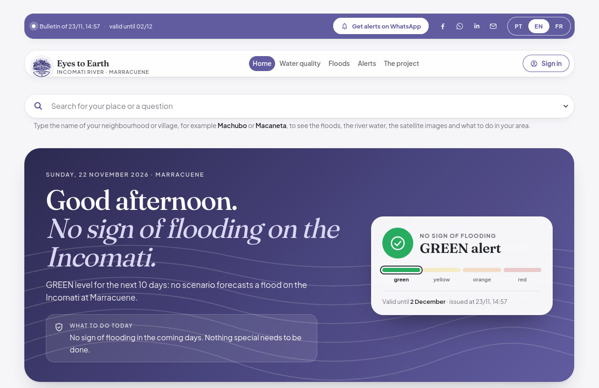
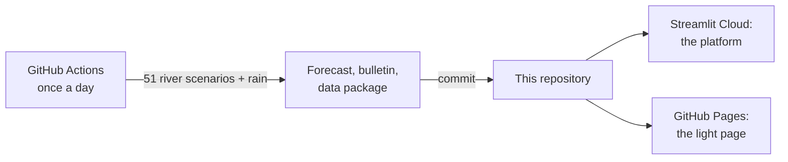

# Eyes to Earth (ETE): water quality and flood alerts for the Incomati River, Marracuene

**Machine learning and satellite data for water-quality monitoring and flood alerts on the lower Incomati River,
Marracuene district, Mozambique.** Every day the platform says, in plain language and in Portuguese, English and
French, how the river water looks and whether the river is likely to flood in the next ten days. It runs on open data
only, by itself, at no hosting cost. The project also ran two student workshops on satellites and artificial
intelligence.

| | |
|---|---|
| **Platform** | <https://ete-platform.streamlit.app> |
| **Light page of the daily bulletin** (weak connections) | <https://ezequiasmiocha.github.io/ete-platform/> |
| **Documentation** (how we built it, how to use it, data, models, tests) | [documentation/](documentation/README.md) |
| **Student workshops** | [workshops/](workshops/README.md) |



## Where to start

| If you want to... | Go to |
|---|---|
| Understand the project | [Project overview](documentation/01-project-overview.md) |
| Use the platform | [User guide](documentation/09-user-guide.md) |
| See how it was built, step by step | [How we built it](documentation/03-how-we-built-it.md) |
| Check the science and the tests | [Flood models](documentation/05-flood-models.md), [Forecast and alerts](documentation/06-forecast-and-alerts.md), [Water quality](documentation/07-water-quality.md), [Validation and limitations](documentation/11-validation-and-limitations.md) |
| Run or change the software | [Developer guide](documentation/10-developer-guide.md) |
| See the workshops for students | [workshops/](workshops/README.md) |

## What is in this repository

```
ete-platform/
├── documentation/   English documentation: 12 pages with charts, maps, satellite images and screenshots
├── plataforma/      the web application (Streamlit) and the small data package it reads
├── src/ete/         the project library: download, processing, models, forecast, data package
├── models/          trained models and their cards
├── scripts/         daily pipeline, data updates, notebook and workshop builders, publication
├── config/          config.yaml: study area, grids, periods, datasets, alert settings, addresses
├── notebooks/       the research notebooks, week by week (Portuguese, with their results)
├── reports/         every figure and table of the project, presentation and print maps
├── workshops/       Workshop 1 (31 Oct 2026) and Workshop 2 (21 Nov 2026): lessons, data, solutions, manuals
├── guias/           practical guides in Portuguese (user manual, publishing, WhatsApp alerts, plan status, runbook)
├── data/            only the small data the bulletin needs (the 43 GB of satellite data are rebuilt by the notebooks)
├── qgis/            QGIS project of the study area
├── servidor/        kit for an own server and domain (prepared, not in use)
├── logos/           project and supporter logos
├── docs/            the light bulletin page served by GitHub Pages (written every day; do not edit)
└── .github/         workflows: daily bulletin, tests, keep-awake visit
```

Each folder has a `README.md` (or `LEIA-ME.md` in Portuguese) that explains its content.

*In the project computer the Portuguese guides are in `docs/`; in this repository they are in `guias/`, because `docs/`
holds the GitHub Pages page.*

## How it runs every day



The daily bulletin is issued by GitHub Actions (`.github/workflows/boletim_diario.yml`) and committed here, so the
history of this repository is also the history of every bulletin. Tests run on every change
(`.github/workflows/testes.yml`). Details in [Platform architecture](documentation/08-platform-architecture.md).

## Quick start

```bash
git clone https://github.com/EzequiasMiocha/ete-platform.git
cd ete-platform
python3 -m venv .venv && .venv/bin/pip install -r requirements.txt
.venv/bin/python plataforma/leitor.py --sem-prazo      # the data package is complete
.venv/bin/streamlit run plataforma/app.py              # http://localhost:8501/?lang=en
```

## Important

Experimental service. It does not replace the official warnings of INGD, INAM and ARA-Sul: if the authorities give an
order, follow the order. The colour of the water says how much mud it carries, not whether it is safe: river water must
always be treated before drinking.

Project funded by the IAU Office of Astronomy for Development (OAD), with the support of DARA (Development in Africa
with Radio Astronomy).

Data: Copernicus (Sentinel-1, Sentinel-2, DEM, GloFAS, EMS, ERA5), NASA and USGS (Landsat, IMERG, SMAP), ESA, JRC,
ECMWF, UCSB-CHC (CHIRPS), Google (Dynamic World, Open Buildings), WorldPop, Open-Meteo, OpenStreetMap, GeoNames.

*Em português: a plataforma está em <https://ete-platform.streamlit.app>, o manual do utilizador em
`guias/manual_do_utilizador.md` e os workshops em `workshops/` (cada um com o seu `LEIA-ME.md`).*
