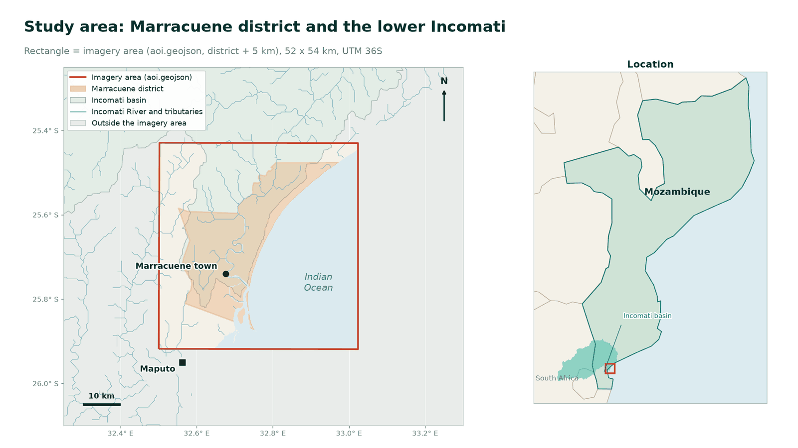
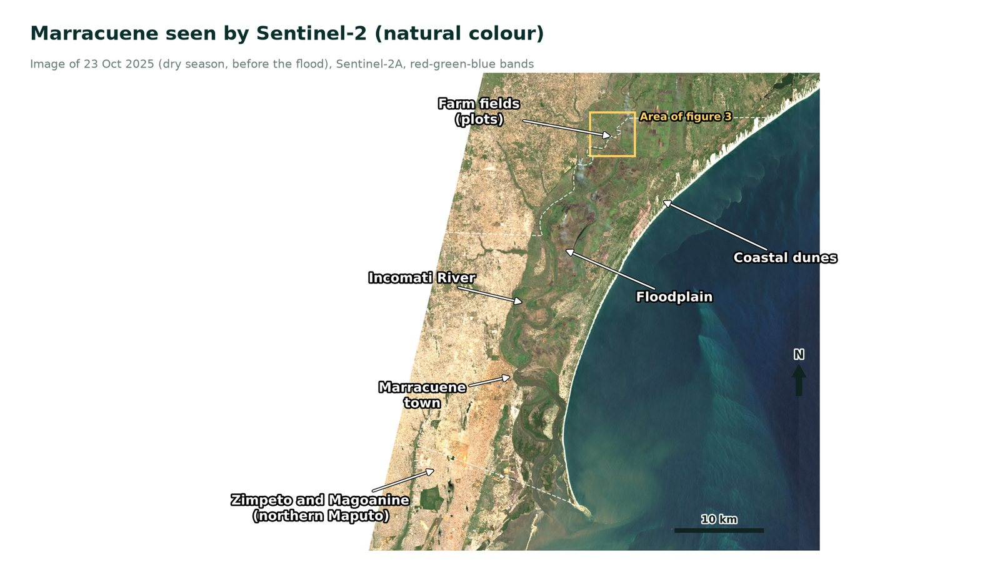
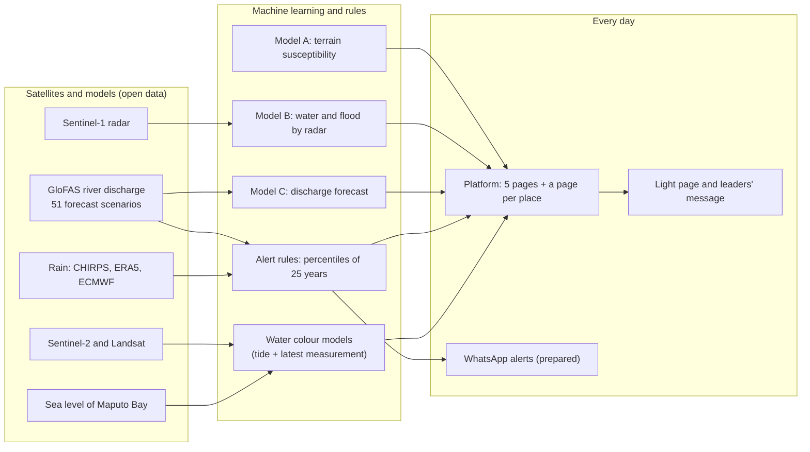

# 1. Project overview

[Documentation home](README.md) · Next: [2. Data sources](02-data-sources.md)

## The problem

The Incomati rises in South Africa (Mpumalanga), crosses Eswatini and enters Mozambique at Ressano Garcia. After more
than 400 km it reaches the sea in Maputo Bay, right next to the town of Marracuene. Its basin is about 46,600 km²,
some 66 times the size of Marracuene district, so rain that falls far away, in another country, decides whether the
floodplain of Marracuene goes under water.

Two things are missing for the people who live along the lower Incomati:

1. **Water that no one follows.** River water is used every day for irrigation, fishing, livestock and at home. There
   is no public water-quality station anywhere in the basin in the UN global water-quality archive (GEMStat).
2. **Floods without warning.** Farmers, fishers and families live and work on a plain that floods. When the river
   rises, the information exists in satellites and global models, but it does not reach the people who need it, in
   words they can act on.

The January 2026 flood showed the stakes. On 19 January the river carried about 2,990 m³/s past Marracuene (GloFAS
estimate), the highest flow since 2006. Water covered about 239 km² of the district, a third of its area, including
1,935 buildings and 46 km² of farmland.

## Our two objectives

| Module | Question it answers | What the platform shows |
|---|---|---|
| **1. Quality: watching the river water** | Is the water today more turbid than usual for this time of year? | The colour of the water seen by satellite in nine river sections from the border to the mouth, a forecast for the coming mornings and weeks, and advice on what to do with the water |
| **2. Quantity: warning of floods** | Will the river flood in the next ten days, and where does the water arrive first? | A 10-day alert level (green, yellow, orange, red), the warning zones with the names of the places, satellite images of the 2026 flood, and twenty years of history |

Both modules end in the same place: one plain sentence, one picture and one piece of advice, updated every day,
in Portuguese, English and French, and readable on a cheap phone with little data.

## The study area

*Figure 1.1. Marracuene district (orange), the imagery area used for 10-30 m data (red rectangle: district plus 5 km,
52 × 54 km in UTM zone 36S) and the Incomati basin, which spreads over three countries.*

*Figure 1.2. The district from space in the dry season (Sentinel-2A, 23 October 2025): the meandering river, the wide
floodplain with farm plots, the coastal dunes and the edge of Maputo.*

The project covers two scales:

- **The district and its floodplain**, at 10-30 m, for floods, warning zones and the water colour of the last 40 km of
  river (Manhiça, Marracuene and the estuary).
- **The whole river in Mozambique**, from the border at Ressano Garcia to the mouth, cut into nine sections (Q1 to Q9)
  for water quality, and **the whole basin** for rain and river flow.

## Who it is for

| Group | What they get |
|---|---|
| Families and community leaders | In one sentence: is there danger, what to do. A daily message to share by WhatsApp or SMS with people without internet. |
| Farmers, livestock keepers and fishers | When the river will rise and how the water they use is doing. |
| Local authorities and civil protection | Maps of where the water arrives first and what is exposed, in support of official warnings. |
| Students and researchers | Open data, methods explained, results that can be repeated, and the tests that failed. |

The platform deliberately does not show team members or internal project matters: it is a public service, not a
project report.

## How it works, in one picture

*The alert level itself is not machine learning: it comes from simple, transparent rules (forecast flow and rain
compared with 25 years of history), because an alert must be explainable in one sentence. Machine learning is used
where it clearly beat simpler methods in tests: detecting water under clouds, mapping susceptibility, forecasting the
flow and the colour of the water.*

## What the project is not

- It is not an official warning service. When INGD, INAM or ARA-Sul give an order, people must follow it.
- It does not say whether the water is safe to drink. A satellite sees mud and plants, not germs or chemicals: river
  water must always be treated before drinking, whatever its colour.
- It does not measure turbidity in laboratory units (FNU, mg/L). The colour index is a **relative** indicator: today's
  water compared with the river's own history. The team decided not to take field measurements in this phase, so no
  absolute calibration exists (see [11. Validation and limitations](11-validation-and-limitations.md)).

## Timeline

| When (2026) | What |
|---|---|
| Late September | Project plan: four weeks, data first, then processing, models, platform |
| Week 1 (early October) | 20 years of satellite, climate and river data downloaded and checked |
| Week 2 | Indices, common grid, features, labels and two training tables |
| Week 3 | Models A and B, alert rules, validation on the January 2026 flood; water-quality analysis and Module Q |
| Week 4 | Daily forecast in production, data package, the web application |
| 13-15 November | Published on GitHub and Streamlit Community Cloud; daily bulletin running on GitHub Actions |
| Since then | The bulletin is issued every day without anyone touching a computer |

The detailed story, with the decisions and the evidence behind them, is in [3. How we built it](03-how-we-built-it.md).
