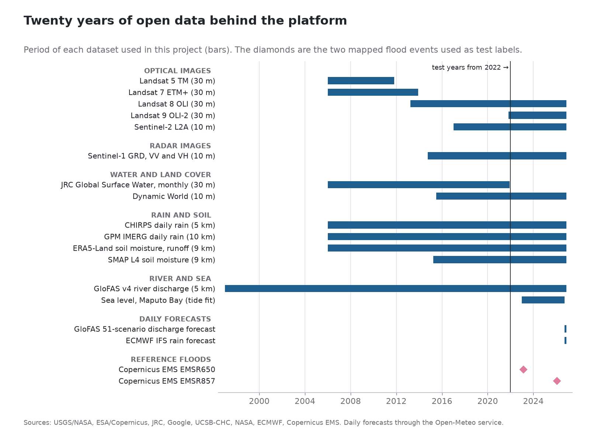
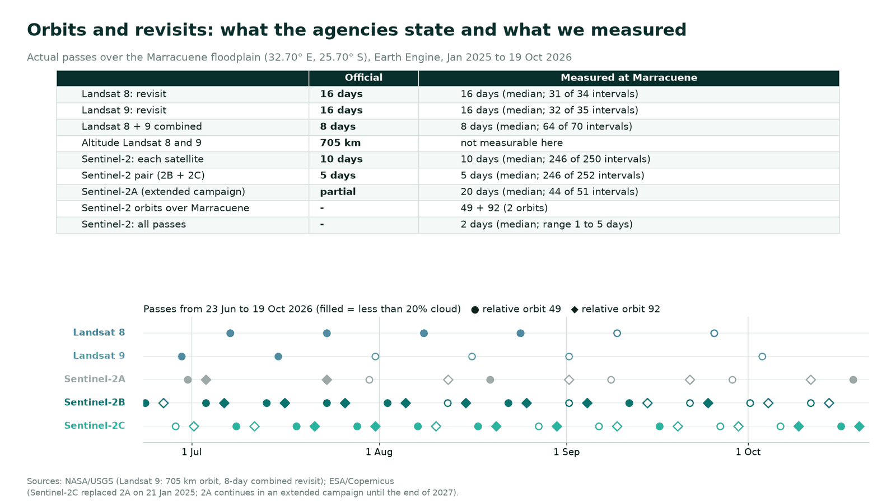

# 2. Data sources

[Documentation home](README.md) · Previous: [1. Project overview](01-project-overview.md) · Next: [3. How we built it](03-how-we-built-it.md)

Everything the platform shows comes from **open data that can be downloaded immediately**, without asking any
institution for access. This was a design choice: a service that depends on a data request can stop the day the
request is not answered.

*Figure 2.1. The period of every dataset used. The vertical line marks 2022: alert limits and models were set on
earlier years and tested on 2022-2026.*

## Datasets

### Satellite images

| Dataset | Provider | Pixel | Period used | Used for | Access |
|---|---|---|---|---|---|
| Landsat 5 TM, 7 ETM+, 8 OLI, 9 OLI-2, Collection 2 Level 2 | USGS / NASA | 30 m | 2006-2026 | 20-year water and colour record, historical training layer | Google Earth Engine |
| Sentinel-2 L2A (harmonised) | ESA / Copernicus | 10 m (20 m red edge) | 2017-2026 | Water colour of the river, flood photographs, place pictures | Google Earth Engine |
| Sentinel-1 GRD, VV and VH | ESA / Copernicus | 10 m | Oct 2014-2026 | Water and flood under clouds (Model B) | Google Earth Engine |
| Dynamic World | Google / WRI | 10 m | Jul 2015-2026 | Permanent-water mask of the narrow upstream river (Module Q) | Google Earth Engine |
| JRC Global Surface Water: occurrence and monthly history | European Commission JRC | 30 m | 2006-2021 | Training labels (water / flood), permanent water | Google Earth Engine |
| ESA WorldCover v200 | ESA | 10 m | 2021 | Land cover (context, features) | Google Earth Engine |

### Terrain and hydrography

| Dataset | Provider | Used for |
|---|---|---|
| Copernicus DEM GLO-30 | ESA / Airbus | Elevation, slope, wetness index |
| MERIT Hydro | University of Tokyo | Height above nearest drainage (HAND), flow accumulation, the main river channel |
| HydroSHEDS / HydroBASINS, Free Flowing Rivers | WWF | Basin and sub-basin outlines, river network |
| FAO GAUL 2015 (level 2) | FAO | District boundary |

### Rain, soil and river

| Dataset | Provider | Resolution | Period | Used for |
|---|---|---|---|---|
| CHIRPS daily | UCSB Climate Hazards Center | 0.05° (~5 km) | 2006-2026 | Basin rain for the alert history and features |
| GPM IMERG V07 daily | NASA | 0.1° | 2006-2026 | Cross-check of CHIRPS |
| ERA5-Land daily | ECMWF / Copernicus | 0.1° (~9 km) | 2006-2026 | Soil moisture, runoff, temperature, evaporation |
| SMAP L4 (collection 008) | NASA | 9 km | Apr 2015-2026 | Reference to calibrate ERA5-Land soil moisture |
| GloFAS v4 reanalysis (LISFLOOD) | Copernicus Emergency Management Service | 0.05° | 2006-2026 | River discharge at Marracuene (no public gauge exists) |
| GloFAS v4 history and 51-member forecast | CEMS, through the Open-Meteo flood API | 0.05° | 1997-today, +30 days | Alert limits, daily forecast, Model C |
| ECMWF IFS rain forecast, ERA5 archive | ECMWF, through Open-Meteo | about 0.25° | 1984-today, plus the forecast days | Basin rain for the daily alert |
| Sea level of Maputo Bay | Open-Meteo marine API | hourly | 2023-2026 | Fitting the tide constants |

### Labels, exposure and places

| Dataset | Provider | Used for |
|---|---|---|
| Copernicus EMS activation **EMSR857** (January 2026, AOI06 Palmeira) | Copernicus Emergency Management Service | Independent test of the flood models; warning zones |
| Copernicus EMS activation EMSR650 (February 2023) | Copernicus EMS | Checked: it maps no flooded area inside the study area |
| WorldPop 2020 | University of Southampton | Upper estimate of people per zone (used with care) |
| Google Open Buildings v3 (confidence ≥ 0.70) | Google Research | Buildings in each warning zone and near each place |
| OpenStreetMap | OSM contributors | Roads, schools, health units, place names |
| GeoNames | GeoNames | More place names (some are old farm names) |

## How much data

About **43 GB** of raw data sits on the project computer, almost all of it imagery:

| Folder | Size | Content |
|---|---|---|
| `data/raw/optical` | 19 GB | Monthly Landsat and Sentinel-2 composites, single-day flood scenes |
| `data/raw/radar` | 16 GB | Monthly Sentinel-1 composites (VV, VH, angle, 10th percentiles, number of passes) |
| `data/raw/land_cover` | 4.6 GB | Dynamic World monthly |
| `data/raw/labels` | 1.0 GB | JRC monthly water, Copernicus EMS products |
| `data/raw/exposure` | 0.44 GB | WorldPop, Open Buildings, OpenStreetMap |
| everything else | < 0.3 GB | Rain, soil, discharge, terrain, tide, places, water-quality tables |

The published platform needs none of it: it reads a **data package of about 11 MB** (see
[8. Platform architecture](08-platform-architecture.md)).

## When the satellites pass over Marracuene

We did not trust the nominal revisit times: we measured the real passes over the floodplain from the Earth Engine
catalogue.

*Figure 2.2. Marracuene lies under two Sentinel-2 relative orbits (49 and 92), so a Sentinel-2 image is taken every
2 days on average (1 to 5). Landsat 8 and 9 together pass every 8 days. Many of those images are cloudy, which is why
the radar matters for floods.*

## Do the sources agree?

Before using several sources side by side we compared them where they overlap (2017-2021).

| Pair | Variable | Agreement |
|---|---|---|
| Landsat vs Sentinel-2 | MNDWI (water index) | R² 0.93, bias -0.006 |
| Landsat vs Sentinel-2 | NDVI | R² 0.84 |
| CHIRPS vs IMERG | Monthly basin rain | R² 0.91, mean difference about 13 mm per month |
| SMAP vs ERA5-Land, raw | Surface soil moisture (basin) | R² 0.80, bias +0.11 m³/m³ |
| SMAP vs ERA5-Land, after quantile mapping | Surface soil moisture (basin) | R² 0.80, bias -0.001 m³/m³ (tested on 2022+ too) |
| JRC water vs Sentinel-1 VV | Water / not water | ROC-AUC 0.95 (0.82 outside permanent water) |

## Conventions

- **One grid.** Every raster is on one fixed grid in UTM zone 36S (EPSG:32736): 30 m for the historical layer, with the
  10 m grid nested inside it. Coarse products (rain, soil, discharge) stay on their native grid and cover the basin.
- **Integers with a scale.** Monthly imagery is stored as int16 (reflectance × 10,000, radar dB × 100); the factor is
  written in the GeoTIFF band scale, and the code always reads physical values through `ete.series.read_scaled` or
  `ete.rasters.read_bands`.
- **Nothing is filled.** A pixel or a month with no observation stays missing (-9999 or 255); nothing is interpolated.
  Each composite keeps an `n_obs` band with the number of clean observations.
- **Every download is logged** in a manifest with its source, period and status (`downloaded`, `absent`, `failed`), and
  downloads resume where they stopped.
- **Decisions are measured, not assumed.** Two examples:
  - The usual Landsat 5/7 to Landsat 8 harmonisation (Roy et al., 2016) was **switched off**: on this area it lowered the
    water MNDWI of Landsat 7 from 0.68 to 0.16, because its intercepts lift the near-zero signal of water.
  - SMAP collection 007 stopped in June 2025, so the project moved to collection 008.

## Licences and credit

Copernicus data (Sentinel, DEM, GloFAS, EMS, ERA5) are free and open under the Copernicus licence. Landsat, IMERG and
SMAP are public domain (USGS/NASA). CHIRPS, JRC GSW, Dynamic World, WorldCover and WorldPop are open (CC BY or similar).
Open-Meteo data are CC BY 4.0; check its terms before any commercial use. OpenStreetMap is © OpenStreetMap
contributors (ODbL). Full references are in [12. Glossary and references](12-glossary-and-references.md).
