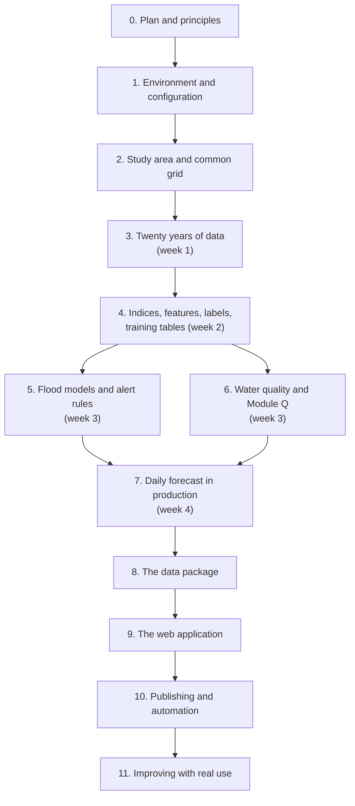

# 3. How we built it, step by step

[Documentation home](README.md) · Previous: [2. Data sources](02-data-sources.md) · Next: [4. Satellite imagery](04-satellite-imagery.md)

This page tells the whole construction in order, from an empty folder to a platform that issues a bulletin every
morning by itself. Each step lists what was done, the code that does it, how it was checked, and the decisions that
changed the plan. The science behind each step is detailed in pages 4 to 7.

## Where the work lives

| Part | Place | In this repository? |
|---|---|---|
| Library with all the logic (download, processing, models, forecast, package) | `src/ete/` | Yes |
| Trained models and their metadata | `models/` | Yes |
| Web application and its data package | `plataforma/` | Yes |
| Daily pipeline, data updates, notebook and workshop builders, publication | `scripts/` | Yes |
| Analysis notebooks (in Portuguese), one per data type or task, numbered by week, with their results | `notebooks/` | Yes |
| Figures and tables of every stage | `reports/` | Yes |
| The two student workshops | `workshops/` | Yes |
| Raw and processed data (about 43 GB) | `data/` | Only the small files; the rest is rebuilt by the notebooks |

The notebooks are **generated** by scripts (`scripts/build_notebooks*.py`) and run from top to bottom, so every
figure and table in them can be rebuilt. The logic is never written in a notebook: notebooks call `src/ete/`.

---

## Step 0. Plan and principles

The project was planned as a four-week sprint with a written plan: a list of 68 variables, the tasks of each week, and
a water-quality module (Module Q) for the whole river. Five principles were fixed before writing any code:

1. **Open data only**, available immediately.
2. **One configuration file** (`config/config.yaml`) holds the study area, the grids, the periods, every dataset ID
   and every folder. Nothing is hard-coded twice.
3. **Never invent data**: no gap filling, absent sensors marked as absent.
4. **Test on what the model never saw**: limits and models are set on the past (up to 2019 or 2021) and tested on
   later years and on an independent flood map.
5. **Say what does not work**: rejected methods are kept and published next to the accepted ones.

## Step 1. Environment and configuration

- Python 3 virtual environment with the scientific stack (numpy, pandas, xarray, rasterio, geopandas, scikit-learn,
  XGBoost) and the Earth Engine and Copernicus (CDS/EWDS) clients.
- A Google Cloud project registered for Earth Engine (noncommercial tier: at most about 3 concurrent requests, which
  shapes how downloads are split) and a Copernicus key for GloFAS.
- Credentials in a local `.env` file, never in the code or the repository.
- Notebook `00_setup_and_authentication` checks every dataset ID of the configuration against the Earth Engine
  catalogue before anything is downloaded.

## Step 2. Study area and common grid

Notebook `01_study_area_aoi`, code `src/ete/grid.py`.

- District outline from FAO GAUL 2015; the basin assembled from HydroBASINS (level 12, grouped by main basin) starting
  from a point on the river at Marracuene; the lower sub-basin at level 6.
- **Imagery area** = bounding box of the district plus 5 km (52 × 54 km). **Climate area** = bounding box of the whole
  basin plus 0.25°.
- **One grid for everything**: UTM zone 36S, origin snapped to 30 m so the 10 m Sentinel grid nests exactly inside the
  30 m Landsat grid. Every raster of the project is downloaded straight onto this grid, so pixels line up without
  resampling later.

## Step 3. Twenty years of data (week 1)

Notebooks `02` to `12` and `99`, code `src/ete/gee.py`, `datasets.py`, `series.py`.

| Notebook | What it downloads |
|---|---|
| 02 | Terrain and static layers: DEM, slope, HAND, flow accumulation, WorldCover, JRC occurrence, rivers, distance to river |
| 03, 04 | Daily rain: CHIRPS and IMERG, basin and district means |
| 05 | Monthly Landsat 5/7/8/9 composites at 30 m (cloud and shadow masked from QA_PIXEL) |
| 06 | Monthly Sentinel-1 composites at 10 m: median VV and VH, incidence angle, number of passes |
| 07 | Monthly Sentinel-2 L2A composites at 10 m (clouds, shadows, cirrus and saturated pixels removed with the SCL band) |
| 08 | ERA5-Land and SMAP soil moisture |
| 09 | GloFAS v4 river discharge at Marracuene |
| 10 | JRC monthly water history and a catalogue of candidate flood events |
| 11 | Dynamic World monthly water probability |
| 12 | Exposure: WorldPop, Google Open Buildings, OpenStreetMap |
| 99 | Inventory and quality control: grid alignment, coverage of every month, gaps |

Large rasters are split into tiles under the Earth Engine request limit, downloaded in parallel, resumed if
interrupted, and logged in `data/metadata/download_manifest.csv`. Monthly imagery is masked to the imagery area and
stored as int16 with its scale factor.

Decisions taken at this step, each with its evidence in the notebooks:

- Landsat 5/7 harmonisation **off** (it destroyed the water signal: MNDWI 0.68 → 0.16).
- SMAP moved to **collection 008** when 007 ended.
- The Sentinel-1 composites mix two relative orbits (145 and 72) of the ascending pass; 2015 has only one, so the
  radar models start in 2016.

## Step 4. Indices, features, labels and training tables (week 2)

Notebooks `20` to `29`, code `src/ete/features.py`, `rasters.py`, `drivers.py`, `overlap.py`, `labels.py`, `training.py`.
No internet needed.

1. **Spectral indices and radar change** (20): NDWI, MNDWI, NDVI, NDMI; radar change against a dry-season reference
   (June-September median).
2. **Static stack** (21): elevation, slope, HAND, topographic wetness index, upstream area and three distances: to the
   real river channel (MERIT main stem plus JRC water, not a generalised river line), to any water, to any stream.
3. **Rain features** (22): 3, 7, 14 and 30-day sums for the basin and the district, and the percentile of each 7-day
   sum **for its time of year**, so a wet week in the dry season counts as unusual.
4. **Hydrometeorological series** (23) and **soil-moisture calibration** (24): ERA5-Land quantile-mapped to SMAP on
   2015-2021 and checked on 2022 onwards (bias 0.11 → 0.00 m³/m³).
5. **Overlap analysis** (25): do the sources agree where they overlap (see [2. Data sources](02-data-sources.md)).
6. **Labels** (26): monthly water and flood labels from the JRC monthly history; flood = water outside the permanent
   water (occurrence ≥ 75 %). JRC holds only about half a dozen clear flood months in 2006-2021, and nothing after 2021.
   The independent test came from **Copernicus EMS activation EMSR857**, which mapped the January 2026 flood around
   Palmeira (AOI06).
7. **Two training tables**, one row per sampled pixel and month, stratified so floods are not drowned by dry land
   (per month: 1,500 flood, 300 permanent water, 1,500 low dry ground, 700 other dry ground, plus 40,000 rows from the
   EMS event):

   | Table | Resolution | Rows | Columns | Months |
   |---|---|---|---|---|
   | `train_historico` (layer 1) | 30 m | 670,243 | 80 | 2006-01 to 2026-01 |
   | `train_recente` (layer 2) | 10 m | 311,413 | 96 | 2015-04 to 2026-01 |

   Each table has a data dictionary and a metadata file. Splits: train up to 2019, validation 2020-2021, test 2022
   onwards and the EMS event. Cross-validation uses 3 km spatial blocks, so neighbouring pixels never sit on both sides.
8. **River sections** (29): the river from the border to the mouth cut into nine sections (Module Q, see step 6).

The discovery that changed the radar work came here. On the EMS reference, the **monthly median** of Sentinel-1 VH
separates flood from dry land with ROC-AUC 0.75 only: a flood that lasts a few days disappears in a monthly median. The
**10th percentile** (the darkest moment of the month) reaches 0.97. All 137 Sentinel-1 months were re-composited
with `VV_p10` and `VH_p10`, and the models use them.

Two leaks were found and closed: `jrc_occurrence` and same-month Landsat bands contain the label itself, so they are
not allowed as inputs of the susceptibility model.

## Step 5. Flood models and alert rules (week 3)

Notebooks `30` to `33`, code `src/ete/models.py`, `alerts.py`. Full detail in [5. Flood models](05-flood-models.md).

1. **Model B, water and flood by radar** (30): four algorithms (logistic regression, Random Forest,
   HistGradientBoosting, XGBoost) compared with a selection rule stated before the test; XGBoost chosen. Tested by
   3 km spatial blocks on the EMS map: IoU 0.91. Monthly maps for every Sentinel-1 month
   (`scripts/run_model_b_maps.py`).
2. **Model A, susceptibility of the terrain** (31): XGBoost on eight terrain variables, trained on JRC floods up to
   2019, tested on the 2026 flood it never saw: ROC-AUC 0.96.
3. **Alert engine** (32): daily levels from rain and discharge percentiles; replayed on 2006-2026. On the January 2026
   flood the rules turned orange five days before the first flood map.
4. **Validation report** (33): every model, every test, what is and is not proven.

## Step 6. Water quality and Module Q (week 3)

Notebooks `34` to `38`, code `src/ete/water_quality.py`, `module_q.py`, `module_q_analysis.py`,
`forecast_models.py`. Full detail in [7. Water quality](07-water-quality.md).

1. Monthly colour indices per river reach from Sentinel-2 (34): NDTI follows the river flow; NDCI follows sediment, not
   algae, so it is not reported as chlorophyll.
2. Seven tests of the turbidity indicators (35), image by image, with two independent satellites:
   - NDTI is repeatable between Sentinel-2 and Landsat 8/9; turbidity in FNU with the near-infrared formula is not
     (rejected);
   - flow, rain and season alone do not predict the colour better than the time of year;
   - **the tide does**: the phase of the main lunar tide alone took R² from 0.19 to 0.60. The final model (tide at the
     satellite hour plus the latest satellite measurement) reaches R² 0.65-0.68.
3. Module Q (29, 36, 37, 38): the whole river in Mozambique in nine sections, 2006-2026, normals, anomalies,
   trends, an evidence sheet of the problem.

## Step 7. Daily forecast in production (week 4)

Code `src/ete/forecast.py`, `forecast_models.py`, `operations.py`; scripts `run_daily_forecast.py`,
`check_forecast_system.py`; notebooks `40`, `41`. Full detail in [6. Flood forecast and alerts](06-forecast-and-alerts.md).

- Every day: the 51 GloFAS discharge scenarios for the Incomati at Marracuene and the ECMWF basin rain, both through
  the free Open-Meteo service (a few KB).
- The alert limits were **recomputed** on the service's own 1997-2021 history (164 / 376 / 970 m³/s), because the
  forecast must be compared with limits from the same model.
- Checks before publishing: if the data are missing, old or implausible, the bulletin says **"forecast unavailable"**.
  It never shows green for lack of data.
- Model C (our own XGBoost discharge forecast) is added as a second opinion; the water-colour outlook is added for the
  next mornings.
- Each run is archived so that forecasts can be verified later against what happened.
- A self-test replays the January 2026 flood offline.

## Step 8. The data package

Code `src/ete/platform.py`, script `export_platform_package.py`, reader `plataforma/leitor.py`.

The web application must not need 43 GB of data, Earth Engine or the training code. The package
`plataforma/dados/` (about 11 MB, latitude/longitude) holds only what is shown: light map images with their corner
coordinates, GeoJSON layers, the bulletin, the series behind the charts, model cards and test tables, and a
`catalogo.json` describing every layer (title, legend, colours, limits). `leitor.py` reads it and checks that it is
complete (it must end with `PACOTE COMPLETO`).

## Step 9. The web application

Code `plataforma/app.py` and its modules. Full detail in [8. Platform architecture](08-platform-architecture.md) and
[9. User guide](09-user-guide.md).

The application went through several designs, each one reviewed with screenshots on a computer and on a 390 px phone:

| Version | What changed |
|---|---|
| First sketch | Four pages, Streamlit defaults |
| Design system | A real visual identity, seven pages, back and forward buttons for days, months and years |
| Machine-learning page | Model cards, algorithm comparisons, data-quality checks, the tests we rejected |
| Trilingual | Portuguese, English and French (about 1,750 translated texts), language in the address (`?lang=en`) |
| Advice | What to do with the water and during floods, for seven audiences, based on WHO/UNICEF guidance |
| Simplified | Five pages read from top to bottom, no tabs, one sentence and one picture first, technical detail in closed panels |
| Places | A search bar on every page and a page for each of 84 named places |
| Final look | Colours inspired by the Copernicus programme (purple #615C9F), no emojis, a light phone view with a bottom bar |
| Accounts and alerts | Optional accounts and WhatsApp sign-up, prepared for a hosted database |

## Step 10. Publishing and automation

Script `scripts/build_deploy_repo.py` builds this repository from the project folder; `publicar_plataforma.py`
pulls, rebuilds, tests and pushes in one command. Full detail in [8. Platform architecture](08-platform-architecture.md).

- **GitHub** holds the code, the package and three workflows:
  - *Boletim diário* runs the forecast every day on GitHub's servers (scheduled for 03:15 UTC, 05:15 in Maputo;
    GitHub often starts scheduled runs hours late, in November 2026 around 11:00-13:00 UTC) and commits the
    new bulletin, so no team computer has to stay on;
  - *Testes* checks the package, every page in three languages, the accounts and the alert messages on every change;
  - *Manter a plataforma acordada* opens the app every 4 hours so the free hosting does not put it to sleep.
- **Streamlit Community Cloud** serves the application at <https://ete-platform.streamlit.app> and redeploys it
  when the repository changes.
- **GitHub Pages** serves a light HTML page of the bulletin from `docs/`, the fallback for weak connections or when
  the application is down.

## Step 11. Improving with real use

After publication, the platform was checked against what it actually showed, and corrected:

- **False "plants on the water" alerts.** At Manhiça the indicator read 42 % plants. A test in Earth Engine showed the
  pixels were river banks, tree shadows and leaves. New pixel rules (shadow and pure-water tests, only the river core
  20 m from the banks) and a re-extraction of every image brought it to 1.1 %.
- **A water-colour map** of the latest clear Sentinel-2 day in five fixed steps, then forecasts of the colour up to
  30 days and monthly maps since 2017.
- **Language**: one spelling norm in Portuguese everywhere; translations that a running server did not reload were
  fixed and a test added.
- **Images that failed on the cloud host** were embedded in the page instead of served as static files.

What remains to be done is listed in [11. Validation and limitations](11-validation-and-limitations.md).
