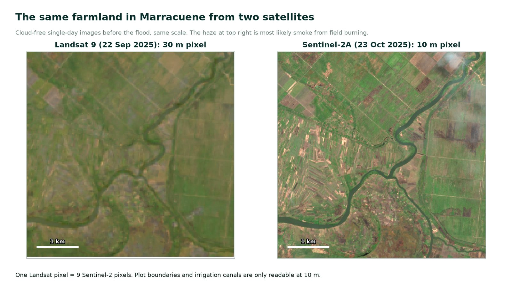
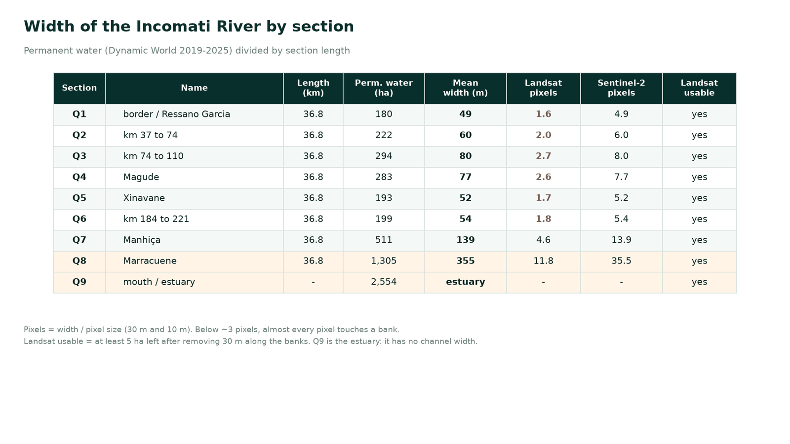
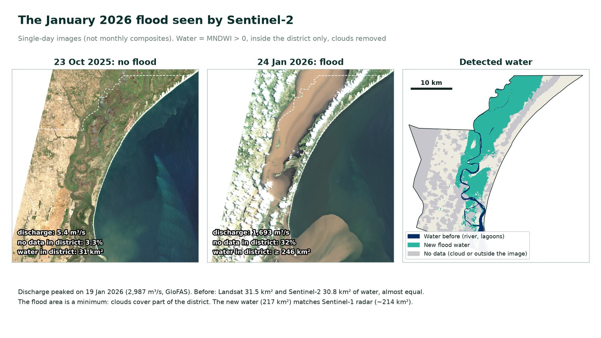
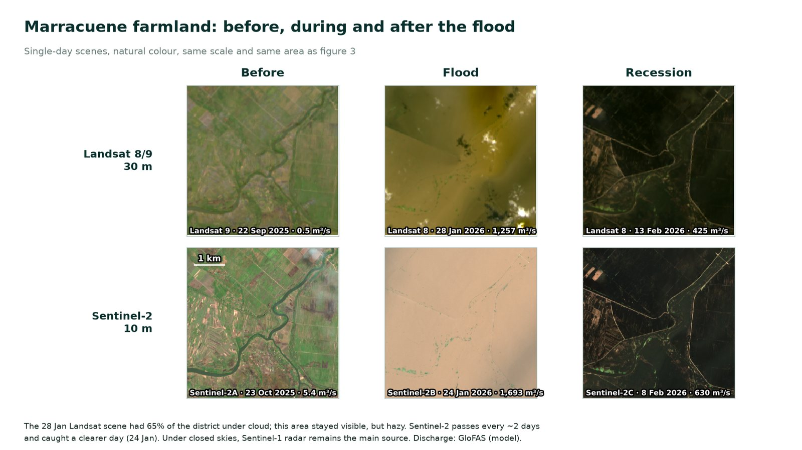
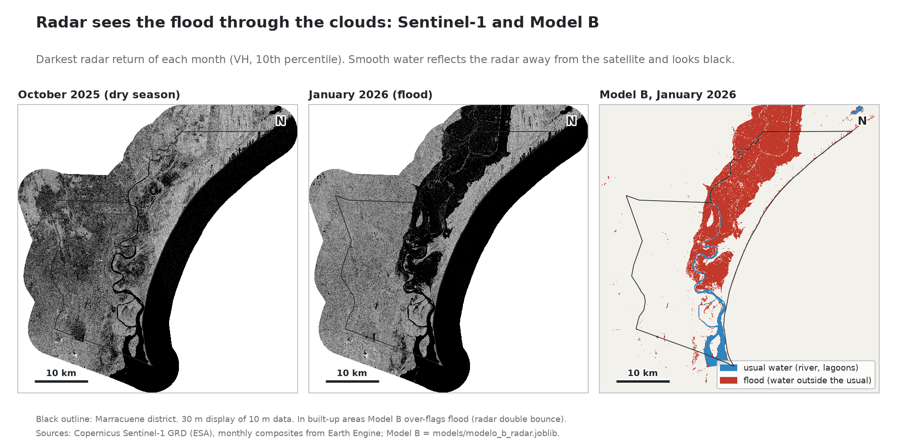

# 4. Satellite imagery

[Documentation home](README.md) · Previous: [3. How we built it](03-how-we-built-it.md) · Next: [5. Flood models](05-flood-models.md)

The platform uses two very different kinds of satellite: **optical** satellites, which take photographs in sunlight
(Landsat, Sentinel-2), and a **radar** satellite, which sends its own microwaves and listens to the echo
(Sentinel-1). This page shows what each one sees over Marracuene, and why the project needs both.

## Optical images: photographs in several colours

Landsat and Sentinel-2 measure the sunlight reflected by the ground in several bands: blue, green, red, near-infrared
(NIR), and short-wave infrared (SWIR). Water absorbs infrared almost completely, so it looks very dark in NIR and SWIR;
vegetation reflects NIR strongly; mud in the water raises the red.

| Index | Formula | What it shows |
|---|---|---|
| NDWI | (green - NIR) / (green + NIR) | Open water |
| MNDWI | (green - SWIR1) / (green + SWIR1) | Open water, better in built-up areas; water when > 0 |
| NDVI | (NIR - red) / (NIR + red) | Green vegetation |
| NDTI | (red - green) / (red + green) | Colour of the water: higher = more sediment (turbidity proxy) |
| NDCI | (red edge - red) / (red edge + red) | Chlorophyll proxy; in this river it follows sediment, so it is not reported |

### Resolution matters

*Figure 4.1. The same farmland of Marracuene on two clear dry-season days: Landsat 9 (30 m pixel) and Sentinel-2A
(10 m pixel). One Landsat pixel holds nine Sentinel-2 pixels; plot boundaries and irrigation channels can only be read
at 10 m.*

This is decisive for water quality. Upstream of Manhiça the Incomati is only 50 to 80 m wide:

*Figure 4.2. Mean width of the river in each Module Q section. Below about three pixels across, almost every pixel
touches a bank and mixes water with land, so sections Q1 to Q6 use Sentinel-2 only (from 2017). Q7 to Q9 are wide
enough for Landsat, which gives them a record back to 2006.*

### Single days, not monthly composites, for floods

Monthly composites (the median of all clear images of a month) are excellent for the normal state of the land, but
they erase a flood that lasts a few days. For the January 2026 flood we downloaded single-day scenes, and chose the
dates by the cloud measured **inside the district**, not by the catalogue's cloud figure (which is per tile).

*Figure 4.3. Before (23 October 2025, 5 m³/s) and during the flood (24 January 2026, about 1,700 m³/s). Water
(MNDWI > 0) inside the district went from 31 km² to at least 246 km²; the new water, 217 km², matches what the radar
found independently (about 214 km²). The flood figure is a minimum: clouds hid 32 % of the district that day.*

*Figure 4.4. The farmland of Figure 4.1 before, during and after the flood, seen by Landsat (top) and Sentinel-2
(bottom). No Landsat image caught the flood without clouds; Sentinel-2, which passes about every two days, did.*

## Radar: seeing through clouds, day and night

Floods come with clouds. Sentinel-1 carries a C-band synthetic aperture radar: it sends microwave pulses and measures
the echo, whatever the weather or the time of day. Calm water acts like a mirror and reflects the pulse away from the
satellite, so it appears **black**; rough land and vegetation send part of it back and appear grey.

The project uses two polarisations, VV and VH, from monthly composites at 10 m, with two statistics for every month:

- the **median**, the normal state of the month;
- the **10th percentile** (`VV_p10`, `VH_p10`), the darkest moment of the month, which keeps a flood that lasted a few
  days. On the January 2026 flood map of Copernicus EMS, VH median separates flood from dry land with ROC-AUC 0.75;
  VH 10th percentile reaches 0.97.

*Figure 4.5. Left and centre: the darkest radar return of October 2025 (dry) and January 2026 (flood); the floodplain
turned black. Right: the same month classified by Model B into usual water and flood water.*

Things to keep in mind with radar:

- Wet fields and some built-up areas can look like water, so Model B over-flags flood there (about 33 km² of "flood"
  in a typical dry month inside the district, see [5. Flood models](05-flood-models.md)).
- The composites mix two relative orbits (145 and 72), with different viewing angles; the incidence angle is a model
  input. In 2015 only one orbit was available, so the radar models start in 2016.
- A fixed change threshold confuses drought with flood. The model, which sees several radar statistics together, does
  better than any single threshold.

## Where the pictures appear on the platform

| Picture | Page |
|---|---|
| Before and during the 2026 flood (Sentinel-2), with a slider | Floods, "The river seen from space" |
| Radar month by month since 2016 (Model B) | Floods, same section |
| Latest clear Sentinel-2 photograph next to the water-colour map | Home and Water quality |
| A 6 km square around each of the 84 places, before and during the flood (radar where clouds covered the photograph) | The page of each place |

How they look on the platform is shown in [9. User guide](09-user-guide.md).
