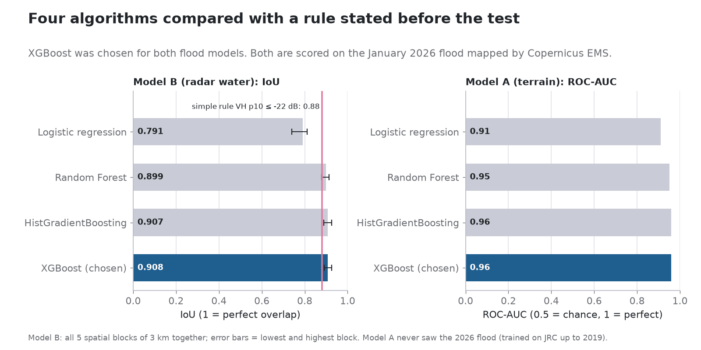
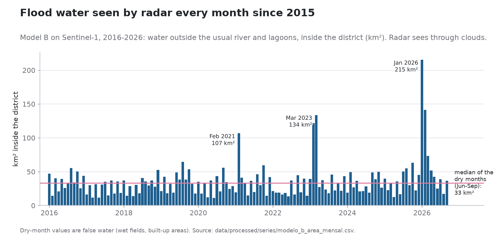
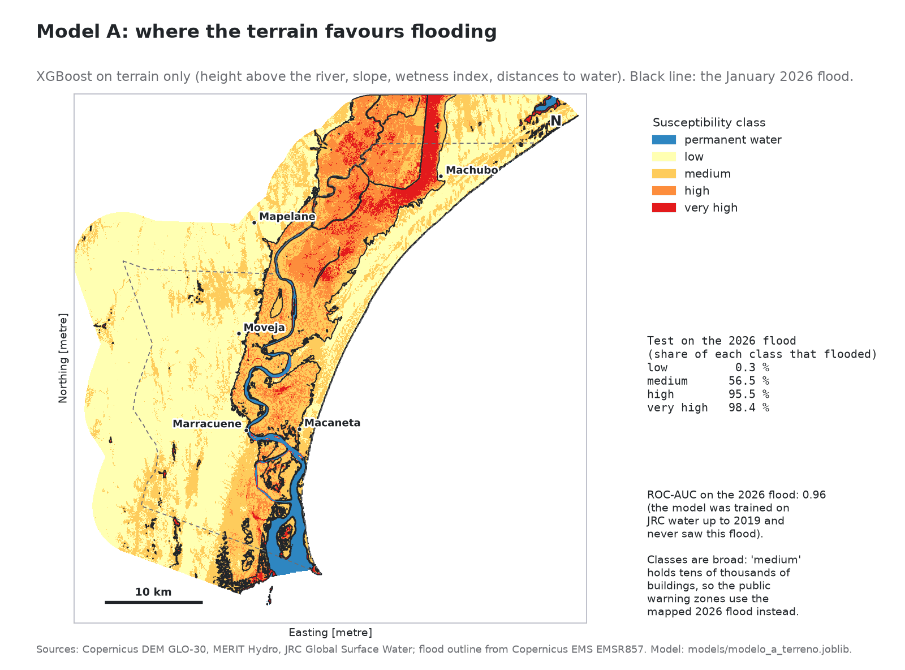
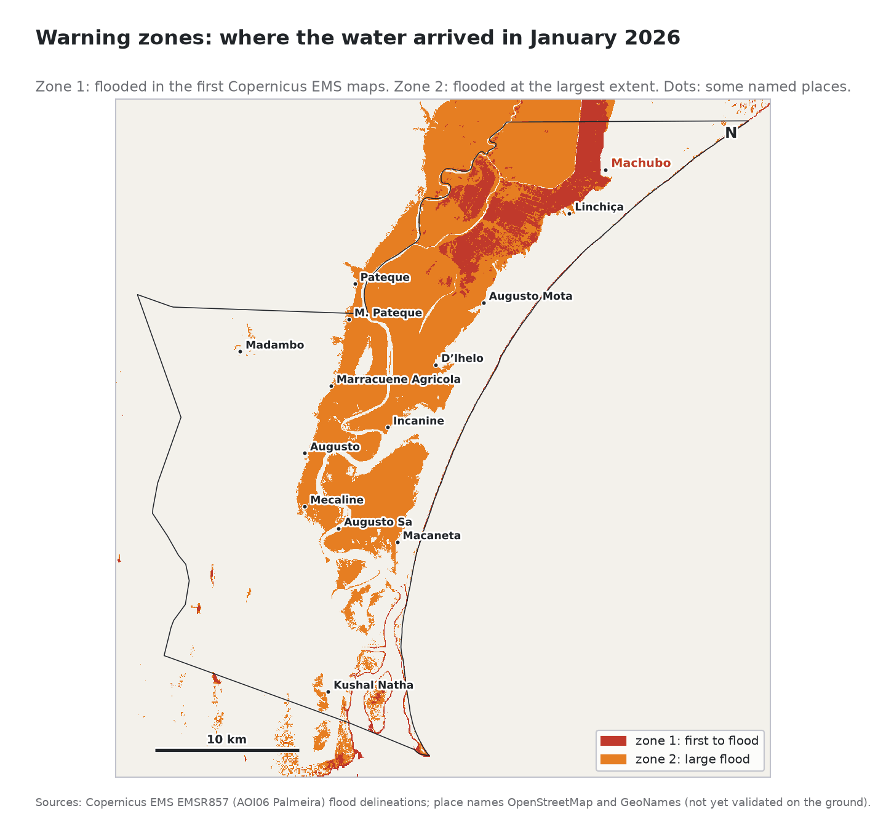

# 5. Flood models

[Documentation home](README.md) · Previous: [4. Satellite imagery](04-satellite-imagery.md) · Next: [6. Flood forecast and alerts](06-forecast-and-alerts.md)

Three flood products answer three different questions:

| Product | Question | Method | Where it is used |
|---|---|---|---|
| **Model B** | Where is the water this month, even under clouds? | XGBoost on Sentinel-1 radar | Radar maps month by month since 2016; the flood picture of the place pages where clouds hid the photograph |
| **Model A** | Where does the terrain favour flooding? | XGBoost on terrain variables | Technical map; tested on the 2026 flood |
| **Warning zones** | Where does the water arrive first, and what is there? | The Copernicus EMS maps of the January 2026 flood | The public "where the water arrives first" map, the places and the exposure |

A third model, Model C, forecasts the river flow and is described in [6. Flood forecast and alerts](06-forecast-and-alerts.md).

## How the algorithms were chosen

For both Model A and Model B, four algorithms were compared with reasonable, **untuned** settings: logistic
regression, Random Forest, HistGradientBoosting and XGBoost. The choice followed a criterion **written before seeing
the results**:

- **Model B**: the highest mean IoU over the five groups of spatial blocks. If the gap to the second is smaller than
  the variation between groups, it is a tie; then the one that wins in more groups; then the fastest.
- **Model A**: the highest ROC-AUC on the **validation** years (2020-2021). The 2026 test does not enter the choice;
  it is only reported.

With a single test event, tuning hyper-parameters would mean fitting the model to the test, so none was done.

*Figure 5.1. Logistic regression is clearly behind: the relation between radar and water is not a straight line. The
three tree ensembles are within the variation between blocks of one another, so any of them would have been
defensible; XGBoost won by the stated rule for both models.*

## Model B: water and flood by radar

| | |
|---|---|
| Algorithm | XGBoost classifier: 300 trees, depth 6, learning rate 0.1 |
| Inputs (9) | VV, VH, VV_p10, VH_p10, VV/VH ratio, ratio of the 10th percentiles, change of VV_p10 and VH_p10 against the dry-season reference, incidence angle |
| Target | Water in the pixel that month (JRC monthly water); flood = water outside the usual water |
| Training rows | 140,000, of which 40,000 from the January 2026 EMS flood map; JRC months from 2016 to 2021 |
| Output | Probability of water at 10 m; water from 0.5; patches under 25 pixels removed |
| File | `models/modelo_b_radar.joblib` (+ `.json`) |

**Why part of the 2026 event is in the training set.** The JRC monthly labels hold almost no short floods, and nothing
after 2021. Without examples of a real flood, the model never learns what a flood looks like in the 10th-percentile
radar. So the EMS event is split into 3 km blocks: each block is predicted by a model that never saw that block. The
honest name of this test is "new places of the same event", not "a new event".

**Why there is no terrain and no optical input.** Inputs were compared too:

| Inputs | IoU on the EMS flood |
|---|---|
| Simple rule: VH 10th percentile ≤ -22 dB | 0.88 |
| Radar (chosen) | 0.90-0.91 |
| Radar + terrain | 0.91 |
| Radar + Sentinel-2 optical | 0.93 |

Terrain adds almost nothing and makes the model learn where water *usually* is, which is the wrong lesson for a flood
detector. Optical indices help a little, but they are empty exactly when floods happen (under clouds). The model must
beat the one-line physical rule, and it does, modestly.

**Results**, January 2026 flood, five groups of 3 km spatial blocks:

| IoU | F1 | Cohen's kappa | Precision | Recall | ROC-AUC |
|---|---|---|---|---|---|
| 0.908 | 0.952 | 0.886 | 0.985 | 0.920 | 0.983 |

On the JRC water of 2016-2021 (control), ROC-AUC is 0.99.

*Figure 5.2. Flood water inside the district, every month since 2016. The three wet seasons with real floods stand out
(2021, 2023, 2026). In dry months the model still reports about 33 km² of "flood": wet fields and built-up areas that
the radar confuses with water. This background is why the public warning zones do not come from Model B.*

## Model A: where the terrain favours flooding

| | |
|---|---|
| Algorithm | XGBoost classifier: 300 trees, depth 6, learning rate 0.1 |
| Inputs (8) | Height above the nearest drainage (HAND), slope, topographic wetness index, elevation, upstream area (log), distance to the river channel, to any water, to any stream |
| Target | Flooded in a JRC flood month |
| Split | Train up to 2019 (250,000 rows), validation 2020-2021, test: the January 2026 flood (Copernicus EMS), never seen |
| Classes | Percentiles 50, 80 and 95 of the susceptibility: low, medium, high, very high; plus permanent water |
| File | `models/modelo_a_terreno.joblib` (+ `.json`) |

| Inputs | ROC-AUC 2020-2021 | ROC-AUC 2026 flood |
|---|---|---|
| HAND alone, no model | 0.66 | 0.77 |
| Terrain without the distances to water | 0.93 | 0.92 |
| **Terrain (chosen)** | **0.96** | **0.95-0.96** |
| Terrain + rain, discharge and soil moisture | 0.98 | 0.97 |

Adding the weather of the month improves the score a little, but a susceptibility map should describe the land, not one
month; the weather enters through the alert rules instead.

*Figure 5.3. Susceptibility classes and the outline of the 2026 flood. 95.5 % of the "high" and 98.4 % of the "very
high" class flooded; only 0.3 % of the "low" class did.*

**Why the public map does not use Model A.** The "medium" class covers 234 km² and more than 52,000 buildings. Where
the EMS maps give a reference, 56.5 % of this class flooded in 2026 and 43.5 % did not. A warning that sends the same
message to 52,000 buildings, almost half of them in places that stayed dry, would soon be ignored. Model A is kept as a technical layer and as evidence that the terrain
explains the flood pattern.

## Warning zones: where the water arrived in 2026

The warning zones come from the Copernicus EMS delineations of the January 2026 flood (activation EMSR857):

- **Zone 1, first to flood**: water in the first EMS maps (42.5 km², 40 buildings, 11.7 km² of farmland);
- **Zone 2, large flood**: water at the largest extent (zones 1 and 2 together: 238.6 km², 1,935 buildings, 46.3 km²
  of farmland, 232 km of roads, 1 school and 1 health unit).

*Figure 5.4. The two warning zones and some of the named places. Each place has a page on the platform.*

### Places

People look for their neighbourhood, not for a zone number. `src/ete/places.py` joins 86 named points from
OpenStreetMap and GeoNames (84 distinct names) to the zones and orders them by when the water arrived in 2026:

| Category | Places |
|---|---|
| Floods first (zone 1; water mapped there on 17 January 2026) | 4 |
| Floods in a large flood (zone 2) | 18 |
| At the edge of the 2026 flood | 23 |
| Outside the warning zones | 41 |

For each place the platform gives the first date water was mapped, the share of a 500 m circle that flooded,
buildings within 500 m, distance to the river and height above it. The names have **not yet been validated on the
ground**; some GeoNames entries are old farm names.

### People and buildings

Building counts (Google Open Buildings, confidence ≥ 0.70) are the main exposure figure. WorldPop 2020 gives about
24,700 people for the same zones, which does not fit 1,935 buildings: it spreads people over the whole 100 m grid.
When people are shown, the platform says "up to about".

## How far to trust these models

- All flood tests rest on **one event**, the January 2026 flood. Other floods may behave differently.
- Model B over-flags flood in built-up areas and wet fields; its monthly maps are for context, not for warnings.
- Model A's classes are broad; they explain the pattern but are not targeted enough for public warnings.
- The warning zones show where water went in 2026. A bigger flood would go further; a smaller one less far.

More in [11. Validation and limitations](11-validation-and-limitations.md).
