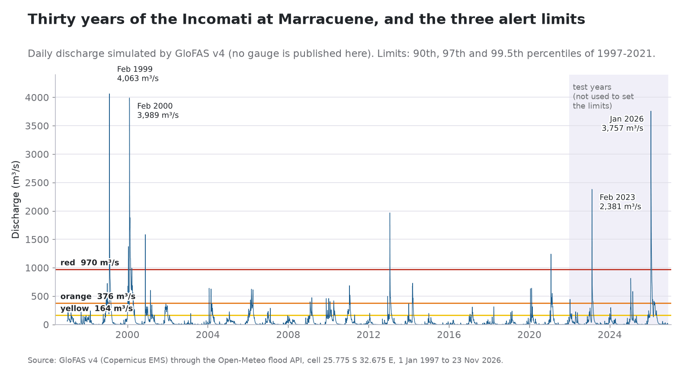
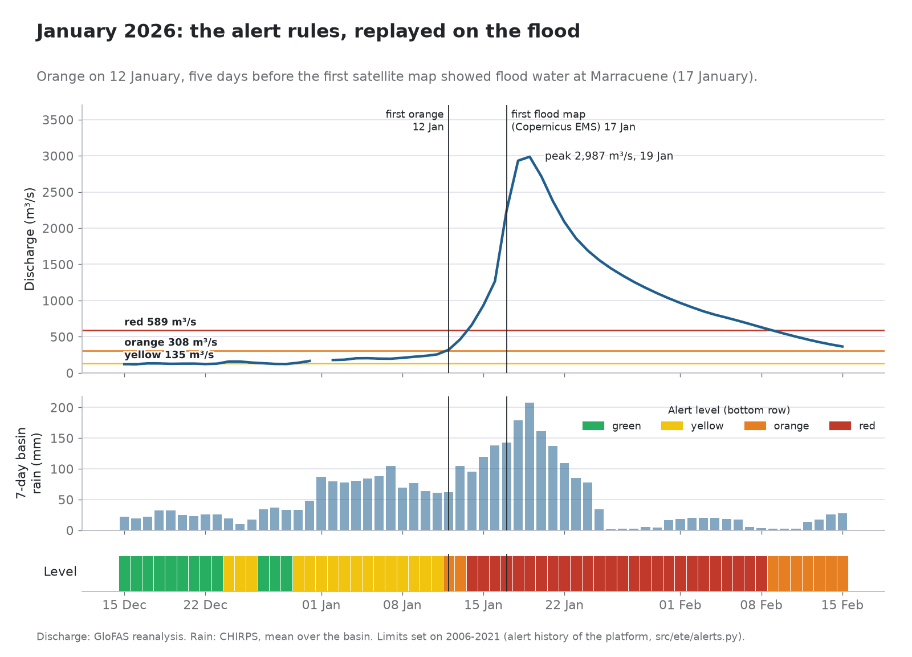
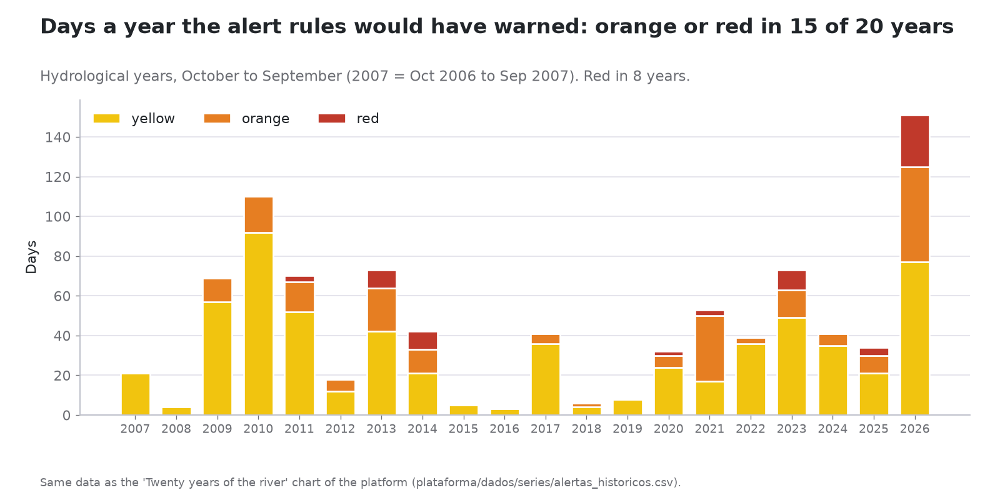
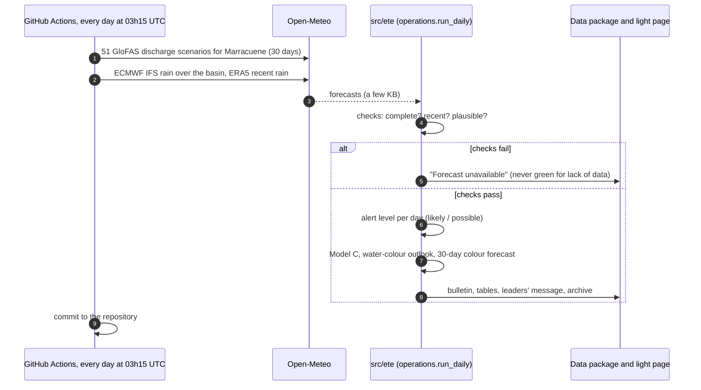
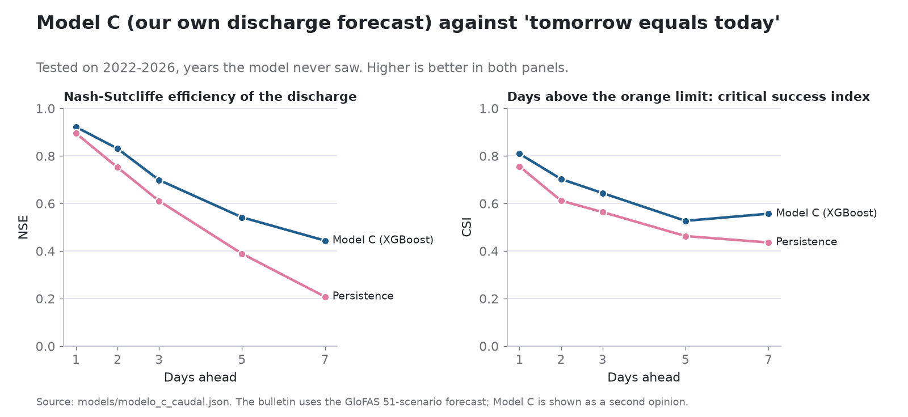

# 6. Flood forecast and alerts

[Documentation home](README.md) · Previous: [5. Flood models](05-flood-models.md) · Next: [7. Water quality](07-water-quality.md)

The flood alert answers one question for each of the next ten days: **how likely is the Incomati at Marracuene to
reach a dangerous flow?** It is deliberately built from simple, transparent rules rather than a black-box model:
an alert must be explainable in one sentence, and its limits must be checkable by anyone.

## The four levels

| Level | Meaning | Rule (daily forecast) | What people are told |
|---|---|---|---|
| **Green** | No sign of flooding | No scenario crosses the limits in the next 10 days | Nothing special needs to be done |
| **Yellow** | Watch | Forecast flow above **164 m³/s**, or 7-day basin rain far above normal for the season | Follow the next bulletins; know where you would go |
| **Orange** | Get ready | Flow above **376 m³/s** in half of the scenarios, or exceptional rain | Protect documents, food and belongings; prepare livestock and the way to higher ground |
| **Red** | Flood likely | Flow above **970 m³/s** in half of the scenarios, or orange rain together with orange flow | Follow the authorities' orders; do not cross flooded areas |

## Where the limits come from

There is no public river gauge for Marracuene, so the flow comes from **GloFAS v4**, the global flood model of the
Copernicus Emergency Management Service. The limits are percentiles of 25 years of its daily flow, **1997-2021**:

| Level | Percentile of daily flow | Limit |
|---|---|---|
| Yellow | 90th | 163.8 m³/s |
| Orange | 97th | 375.8 m³/s |
| Red | 99.5th | 969.9 m³/s |

The rain trigger uses the 7-day basin rain against its **95th (yellow) and 99th (orange) percentile for the same
day of the year**, and never fires below 50 mm. The years 2022-2026 were kept out of the calibration to test the rules.

*Figure 6.1. Daily flow of the Incomati at Marracuene since 1997 from the forecast service's history, with the three
limits. The large floods of 1999, 2000, 2013, 2023 and 2026, and smaller peaks in 2001 and 2021, cross the red line;
most rainy seasons reach yellow or orange.*

> **Two GloFAS series.** The project uses two versions of the same model: the **reanalysis** downloaded from the
> Copernicus data store (2006-2026, used for the 20-year history and the training tables) and the **forecast
> service's history** (1997-today, through Open-Meteo, one grid cell away from the first). They agree closely (r 0.97)
> but not exactly: the January 2026 peak is 2,987 m³/s in the first and 3,757 m³/s in the second. Each set of limits
> is computed from the series it is compared with: 135 / 308 / 589 m³/s for the history replay (2006-2021), and
> 164 / 376 / 970 m³/s for the daily forecast (1997-2021). Both are model estimates, not measurements.

## Would it have warned? The January 2026 flood

The rules were replayed day by day on the observed (reanalysis) flow and rain:

*Figure 6.2. Yellow from the end of December, orange on 12 January, red from 14 January. The first Copernicus EMS map
showing flood water at Marracuene is from 17 January, five days after orange; the largest extent was mapped twelve
days after orange. For the February 2023 activation of Copernicus for Maputo province, the lead was one day.*

This replay uses the flow that actually happened. A real forecast made on 12 January would have had its own errors,
and past forecasts are not archived anywhere we can reach, so **forecast skill itself is not yet proven** (see below).

*Figure 6.3. Replayed on twenty hydrological years, the rules would have reached orange or red in 15 years and red in
8. Most seasons have some yellow days. These are days on which the system would have warned, not floods confirmed on
the ground.*

## The daily forecast

For each of the next ten days the 51 scenarios are compared with the limits:

- **likely level**: the highest level reached by at least **50 %** of the scenarios (the headline level);
- **possible level**: the highest level reached by at least **20 %** of them (shown as "possible").

The rain trigger is used only up to **7 days ahead**, where the rain forecast still has skill. The final level is the
higher of the flow and rain levels, and orange rain together with orange flow becomes red.

### Safety rules built into the code

- If today's data cannot be fetched, the last stored forecast is reused and flagged as a copy.
- If the data fail the checks, or the bulletin is older than **36 hours**, the platform and the light page say
  "forecast unavailable" and point to the official warnings. **It never shows green for lack of data.**
- Every run is archived (`data/processed/forecast/archive/<date>/`, raw answers in `data/raw/forecast/runs/`) so that
  the forecasts can be verified against what happened later (`ete.operations.verification`).

### What the bulletin contains

| File in `plataforma/dados/boletim/` | Content |
|---|---|
| `estado.json` | When the data were fetched, whether they are fresh, problems found. Read it first. |
| `boletim.json`, `boletim.md` | The bulletin for the platform and for people |
| `previsao_alertas.csv` | Per day: flow median and spread, share of scenarios above each limit, rain, levels, Model C |
| `cenarios_caudal.csv`, `chuva_bacia.csv` | The 51 scenarios and the basin rain |
| `turbidez.csv`, `turbidez_diaria.csv`, `cor_prevista.csv` | Water-colour outlook (see [7. Water quality](07-water-quality.md)) |
| `mensagem_whatsapp.txt` | A short text for community leaders, to share by WhatsApp or SMS |

## Model C: our own discharge forecast

GloFAS is the main forecast. Model C is a second opinion trained on the river's own history.

| | |
|---|---|
| Algorithm | One XGBoost regressor per lead time (1, 2, 3, 5, 7 days): 400 trees, depth 5, learning rate 0.05 |
| Inputs | Recent flow (lags and changes, log scale), basin rain sums over several windows, time of year |
| Target | Log of the flow at day t + lead |
| Train / test | 1997-2021 / 2022-2026 (about 1,735 test days per lead) |
| File | `models/modelo_c_caudal.joblib` (+ `.json`) |

*Figure 6.4. Model C against persistence ("tomorrow equals today"). It is better at every lead, and the gap grows with
the lead: at 7 days NSE 0.44 against 0.21, and for days above the orange limit a critical success index of 0.56
against 0.44. It still lags the start of a flood: it learns the rise once it has begun.*

## WhatsApp alerts (prepared, not yet live)

People can sign up on the platform with their WhatsApp number and their place. The sending code
(`plataforma/alertas_whatsapp.py`, `scripts/send_whatsapp_alerts.py`, step 5 of the daily pipeline) follows these rules:

- only **orange and red** (the level that half or more of the scenarios show) produce a message;
- a higher level is sent at once; while an alert lasts, a reminder every 2 days; a "the danger has passed" message when
  it drops; a welcome message right after sign-up;
- each message names the person, lists at least two places at risk (the person's own place first) and includes a
  situation card (flood level, flow chart, ten days of water colour) and two links to the platform;
- phone numbers are never stored in the repository, the package or the logs.

To go live it still needs a Meta Business account with a WhatsApp number, approval of the message templates (texts in
`ALERTAS_WHATSAPP.md`), a hosted database (Supabase) and the matching secrets on Streamlit Cloud and GitHub. Until then
the sign-up form says that sign-ups open soon, and nothing is lost.

## What is and is not proven

| Claim | Status |
|---|---|
| The rules would have warned before the 2026 flood | Yes, on observed (reanalysis) data: orange 5 days before the first flood map |
| The limits hold on years not used to set them | Tested on 2022-2026 |
| The 10-day forecast itself is skilful at Marracuene | **Not yet**: no archive of past GloFAS forecasts exists for this site; our own archive started in October 2026 |
| Model C beats persistence | Yes, on 2022-2026, but it lags flood onsets |
