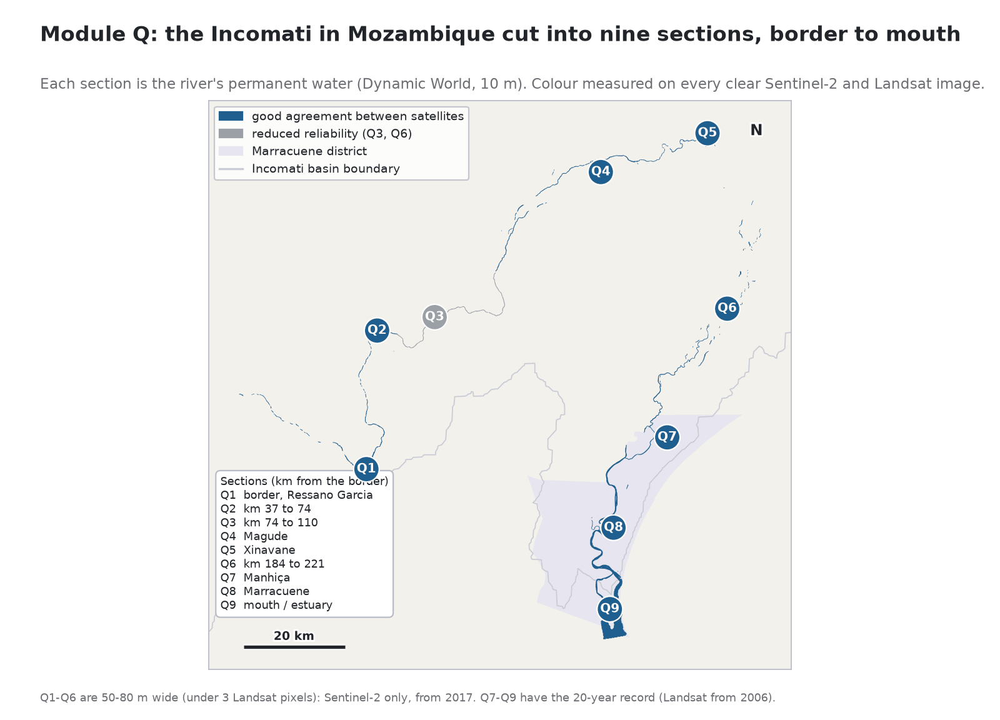
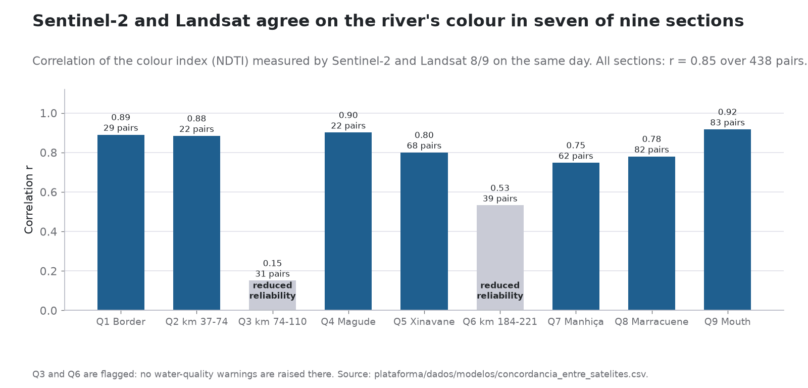
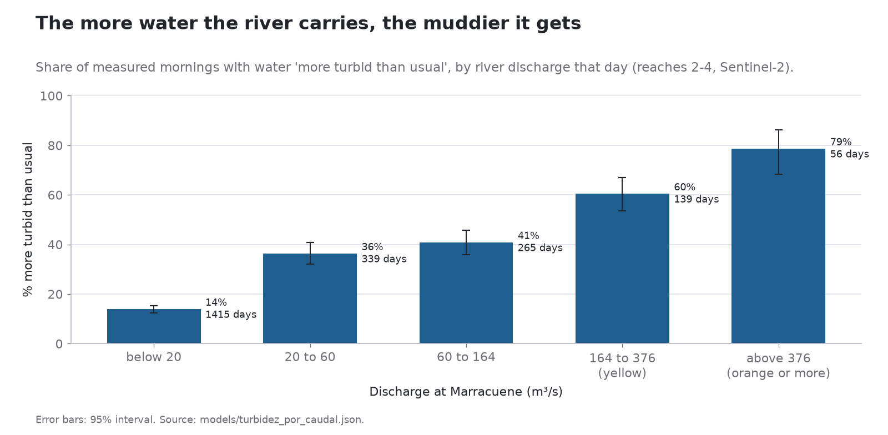
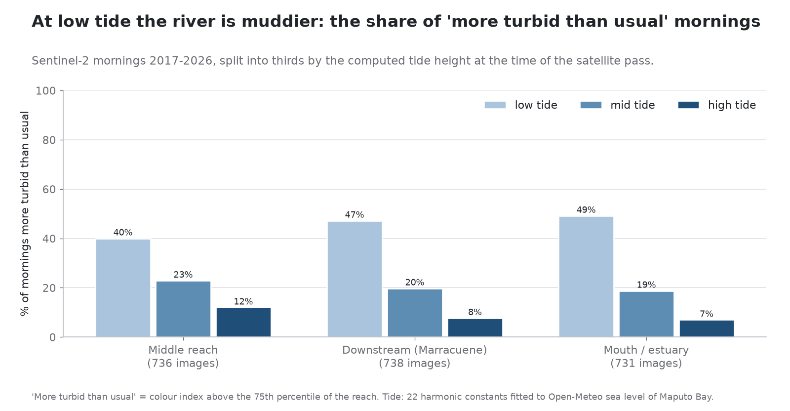
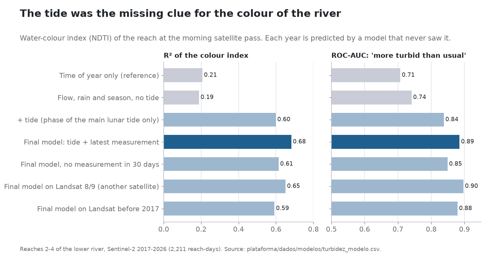
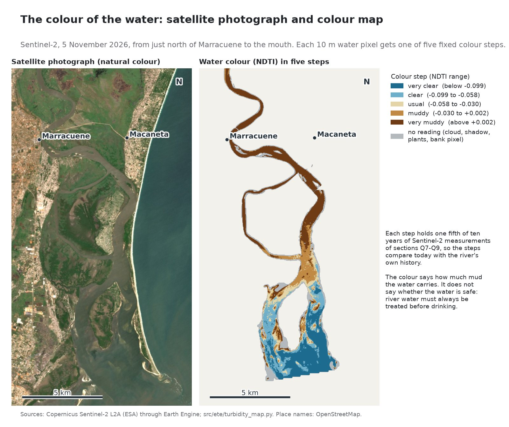
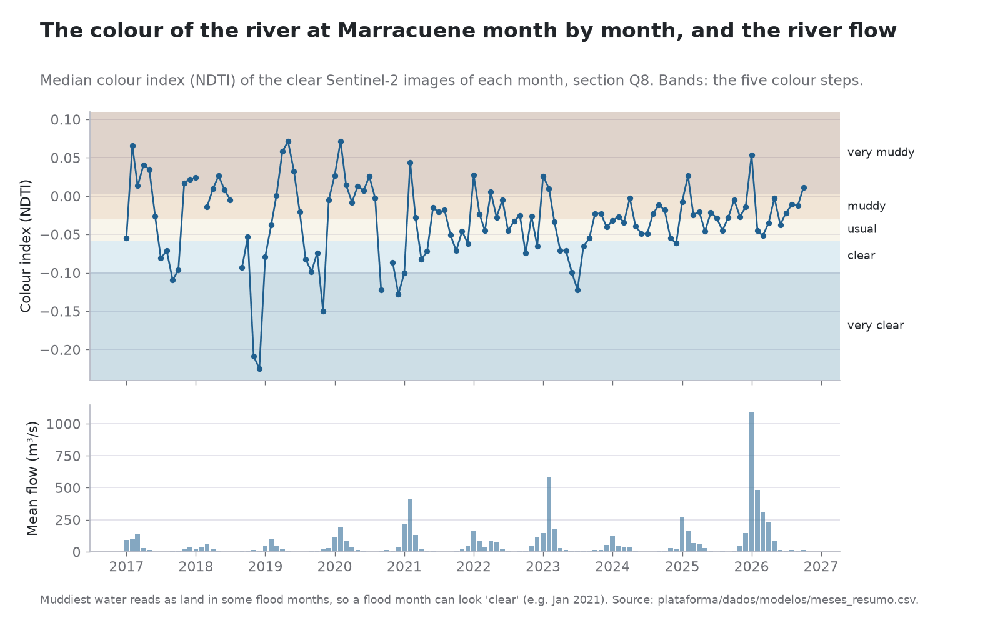
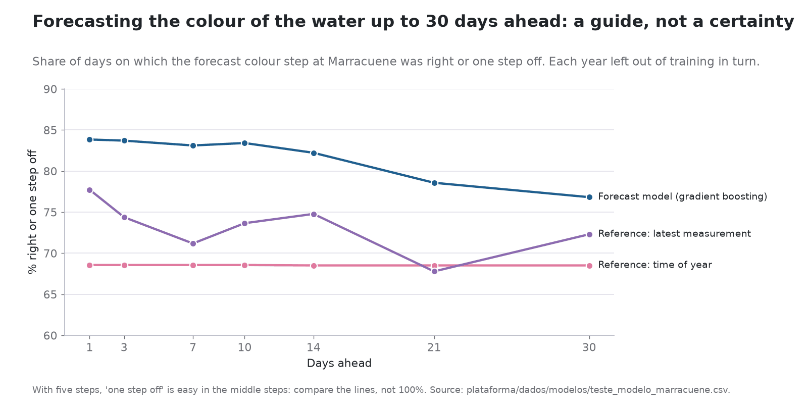

# 7. Water quality

[Documentation home](README.md) · Previous: [6. Flood forecast and alerts](06-forecast-and-alerts.md) · Next: [8. Platform architecture](08-platform-architecture.md)

Watching the water of the river is the project's first objective. No public water-quality station exists in the
Incomati basin, and the team decided not to take field samples in this phase. So the platform measures what a
satellite can measure honestly: **the colour of the water**, compared with the river's own history.

> **What the colour says, and what it does not.** A higher colour index means more suspended sediment (mud) in the
> water. It says nothing about germs, chemicals or pH. Muddy water is harder to disinfect; clear water is not
> necessarily safe. River water must always be treated before drinking.

## The colour index

For each clear satellite image and each river section, the platform takes the **median NDTI** of the pure-water
pixels:

```
NDTI = (red - green) / (red + green)
```

Water rich in sediment reflects more red, so NDTI goes up. A pixel counts as pure water only if it is:

- clear (no cloud, cloud shadow, cirrus or saturation in the scene classification);
- open water in the river's permanent-water mask, and not touching the bank (3 × 3 test);
- **lit**: green reflectance of at least 0.02, so the shadows of trees, clouds and relief are left out;
- for the plants indicator, in the **river core**, at least 20 m from the edge, so leaves and reeds of the banks are
  not counted as plants on the water.

These rules (version 2 of the mask, November 2026) came from a real false alarm: the first version reported 42 % of
"plants" in the Manhiça section, which a pixel-by-pixel check in Earth Engine showed to be banks, shadows and leaves. It
now reads 1.1 %. Every per-image table carries the mask version, and older tables are re-extracted.

## Module Q: the whole river in nine sections



*Figure 7.1. The Incomati in Mozambique, from the border at Ressano Garcia to the estuary, cut into nine sections. The
water mask comes from the Dynamic World water frequency (10 m), because the JRC 30 m map misses most of the 50-80 m
wide upstream river.*

| | |
|---|---|
| Images | 5,276 clear images from 4 January 2006 to 9 October 2026: 3,464 Sentinel-2, 1,346 Landsat 8/9, 466 Landsat 5/7 |
| Sections with a 20-year record | Q7 Manhiça, Q8 Marracuene, Q9 estuary (Landsat from 2006) |
| Sections Q1-Q6 | Sentinel-2 only, from 2017 (too narrow for Landsat) |
| Per section and month | Median colour, the normal for that month, the anomaly, the reliability |
| Code | `src/ete/module_q.py` (sections and Earth Engine extraction), `module_q_analysis.py` (normals, anomalies, trends) |

### Do two satellites agree?

The strongest check available without field data is **two independent satellites measuring the same water on the
same day**.



*Figure 7.2. Sentinel-2 and Landsat 8/9 agree on the colour index (r = 0.85 over 438 same-day pairs, mean difference
-0.004). Q3 and Q6 agree poorly (r 0.15 and 0.53) and are marked "reduced reliability": no water-quality warning is
raised there.*

### What Module Q found

- **Normals and anomalies.** Each section is compared with the same month in other years. About 5 % of section-months
  stand out as unusual (Isolation Forest); they are pointed out, not used to decide anything.
- **Trends.** No 20-year trend is confirmed once the 2013 change of satellite (Landsat 7 to 8) is taken into account.
  Upstream, 2017-2026 goes from clear water in drought years to turbid water in wet years.
- **Expected colour from rain and flow.** A model of "the colour we would expect" only works at the estuary
  (R² 0.52). Elsewhere it does not, so no "unexplained turbidity" flag is raised.
- **The border does not predict Marracuene**: the monthly colours of Q1 and Q8 are unrelated (r -0.06), so the water
  entering Mozambique cannot be used to announce the colour at Marracuene.

## What drives the colour of the lower river

### River flow



*Figure 7.3. Days with water "more turbid than usual" (above the 75th percentile of the reach) by river flow: 14 %
below 20 m³/s, 79 % above the orange flood limit. Floods bring mud. But flow, rain and the time of year together did
not predict the colour of a given morning better than the time of year alone (R² 0.19 against 0.21).*

### The tide: the missing clue

The lower Incomati is tidal. A likely explanation of what the data show: at low tide the river drains towards the sea
and its muddy water reaches the lower reaches and the estuary; at high tide clearer sea water pushes in. The satellite
always passes at about 09:30 local time, but the tide at that hour changes every day, so the same river can look clear
one morning and muddy the next.



*Figure 7.4. Mornings split into thirds by the tide height at the satellite pass. At low tide 40-49 % of the mornings
are more turbid than usual; at high tide only 7-12 %.*

There is no tide gauge with open data at the mouth, so the tide is **computed**: 22 harmonic constituents (M2, S2,
N2, K2, K1, O1 and others) were fitted to the hourly sea level of Maputo Bay from the Open-Meteo marine service
(2023-2026, 32,901 hours). The fit reproduces 98.7 % of the variance of the 12 months left out (RMSE 7.4 cm). The main
lunar tide M2 has an amplitude of 0.74 m and the solar S2 0.46 m (`models/mare_maputo.json`).

### The model of the coming mornings

| | |
|---|---|
| Algorithm | Gradient boosting (scikit-learn), a regressor for NDTI and a classifier for "more turbid than usual": 300 trees, depth 3, learning rate 0.05 |
| Inputs | Flow (log, 7-day mean and maximum, 3-day change), basin rain over 3, 7 and 30 days, time of year, **tide height at the satellite hour, whether it is rising or falling, the tidal range**, the **latest satellite measurement** of the reach (from either satellite, up to 30 days old) with its age, tide and flow, and the reach |
| Reaches | Middle reach, downstream (Marracuene), mouth/estuary. The upstream reach has no forecast (R² 0.20 there). |
| Test | Each year predicted by a model that never saw it (2017-2026) |
| Valid for | About 07:30 UTC (09:30 local), the only time the satellites observe |
| Files | `models/modelo_turbidez.joblib` (+ `.json`), `models/mare_maputo.json` |



*Figure 7.5. From no skill to useful skill. With the phase of the main lunar tide alone, R² went from 0.19 to 0.60;
with the full tide and the latest measurement, 0.68 (ROC-AUC 0.89). Trained on Sentinel-2 only, the model holds on
Landsat images it never saw (R² 0.65), even before 2017 (R² 0.59).*

Tested and **not** used, because they gave no gain: wind at the mouth, local rain, rain per part of the basin, training
on both satellites together (`scripts/experimento_turbidez_entradas.py` in the research workspace).

## The water-colour map and its forecasts

### Today's map

`src/ete/turbidity_map.py` takes the most recent Sentinel-2 day (within 45 days) on which at least 60 % of sections
Q7-Q9 can be read, and classifies every 10 m water pixel into **five fixed steps**. The steps are the quintiles of ten
years of Sentinel-2 measurements in Q7-Q9, so each step holds a fifth of the river's history and two dates can be
compared directly.



*Figure 7.6. 5 November 2026: the river was very muddy at Marracuene and Manhiça, while the estuary, flushed by sea
water, was clear. On the platform the two images are shown with a slider.*

The map, the natural-colour photograph and a transparent layer for the interactive map are refreshed weekly by
`scripts/update_water_quality_scenes.py` (Earth Engine, about 1 MB).

### Month by month, and the past



*Figure 7.7. The monthly colour of section Q8 since 2017, against the five steps, with the river flow below. The river
is muddiest in the wet season and at the start of the dry season. Caution: in some flood months the muddiest water is
read as land, so the month can look clear (January 2021).*

The platform also holds a **monthly map for every month since 2017** (118 months, the median of the clear images of
each month on the same 20 m grid), so a user can look at any month of any year.

### Forecasts up to 30 days

Two models extend the colour forward (`src/ete/water_colour_model.py`):

1. **Marracuene, day by day, up to 30 days**: gradient boosting on the forecast flow, the computed tide, the season and
   the latest measurements. Right or one step off on 84 % of days at 1 day and 77 % at 30 days, against 69 % for the
   time of year. R² stays low (0.2-0.4): the platform presents it as **"a guide, not a certainty"**.

   

   *Figure 7.8. Each year left out of training in turn. With five steps, "one step off" is easy in the middle steps, so
   compare the lines with each other, not with 100 %.*

2. **The map, pixel by pixel**: for every 20 m pixel, the colour is modelled from the colour at Marracuene and the
   tide (pixel NDTI = a + b·Q8 + c·tide), fitted in Earth Engine on 2017-2025 (814 days) and tested on 2026: right on
   47 % of pixels and within one step on 77 %, against 38 % and 73 % for a flat map with Marracuene's colour
   everywhere. Weekly forecast maps use the average tide of the week.

## Plants on the water

The share of the river core covered by green plants is measured per month and section from Sentinel-2. It matters
mainly upstream. A warning is raised only with at least two images and a recent month, in a section with good
reliability.

## From measurement to advice

`plataforma/conselhos.py` turns the day's data into situations (water more turbid than usual, turbid mornings
forecast, flood, after a flood, very low flow, plants, and "always") and gives each one advice for seven audiences:
families, farmers and livestock keepers, fishers, schools, health facilities, those who treat and supply water, and
authorities and community leaders. It includes a six-step guide to treat water at home and what to do about diarrhoea,
based on WHO and UNICEF guidance. The advice does not replace the guidance of the health authorities (MISAU), INGD,
ARA-Sul or the district services.

## What we tested and do not show

| Tested | Result | Decision |
|---|---|---|
| Turbidity in FNU from the near-infrared band (Dogliotti et al., 2011) | The two satellites disagree (r 0.21) | Rejected |
| Turbidity in FNU from the red band (Dogliotti et al., 2015), suspended solids in mg/L (Nechad et al., 2010) | Satellites differ by a typical factor of 1.5; against the GLORIA in-water dataset, unbiased but off by a typical factor of 2.5 | Kept as estimates in the technical tables only, never shown to the public as measurements |
| NDCI as chlorophyll | In this river it follows sediment (r 0.81 with NDTI) | Not reported as algae |
| Secchi depth from red reflectance | Fitted on GLORIA (R² 0.72 in log) | Estimate only |
| ACOLITE atmospheric correction | Not run (Level-1 scenes of about 1 GB each) | Open |
| Machine learning without the tide | No better than the time of year | Replaced by the tide model |

More in [11. Validation and limitations](11-validation-and-limitations.md).
