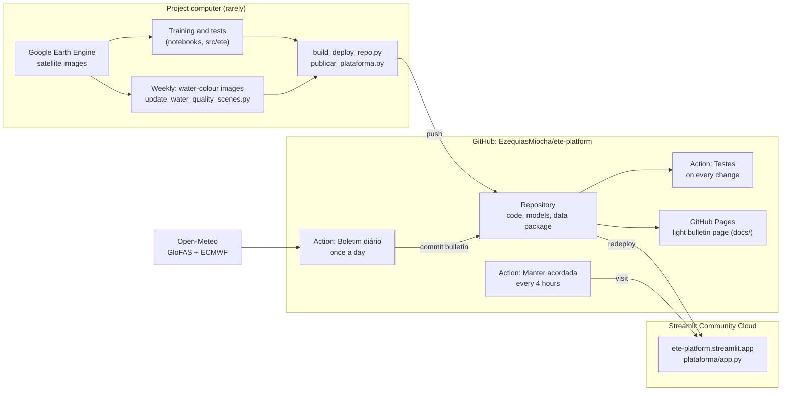

# 8. Platform architecture

[Documentation home](README.md) · Previous: [7. Water quality](07-water-quality.md) · Next: [9. User guide](09-user-guide.md)

The platform is designed to run **without any team computer switched on** and **without paid services**. Heavy work
(satellite downloads, model training) happens rarely, on the project computer. Light work (the daily forecast and
bulletin) happens every day on GitHub's servers. The web application only reads a small data package.

## The big picture



## Repository layout

```
ete-platform/
├── plataforma/                 the web application
│   ├── app.py                  pages and navigation
│   ├── tema.py                 design system: colours, typography, cards, tables, sliders, steppers
│   ├── graficos.py             charts (Altair)
│   ├── idioma.py, textos.py    languages: t() and about 1,750 translations (Portuguese → English, French)
│   ├── leitor.py               reader of the data package, with a completeness check
│   ├── pesquisa.py             search: places and questions, tolerant of accents and small typos
│   ├── conselhos.py            advice: situations of the day × seven audiences
│   ├── curiosidades.py         verified facts about the river and the satellites
│   ├── previsao_mapa.py        weekly water-colour forecast maps (numpy + PIL)
│   ├── contas.py               optional accounts (scrypt password fingerprints, sessions)
│   ├── inscricoes.py           WhatsApp sign-ups (SQLite locally, Supabase in the cloud)
│   ├── alertas_whatsapp.py, cartao_whatsapp.py    alert messages and the situation card
│   ├── testar_app.py, testar_contas.py, testar_alertas.py    tests
│   ├── static/                 logos
│   └── dados/                  THE DATA PACKAGE (about 11 MB)
├── src/ete/                    the project library (download, processing, models, forecast, package)
├── models/                     trained models (.joblib) and their metadata (.json)
├── scripts/                    daily pipeline, data updates, notebook and workshop builders, publication
├── config/config.yaml          single source of truth: area, grids, periods, datasets, limits, addresses
├── notebooks/                  research notebooks, week by week (Portuguese), with their results
├── reports/                    figures and tables of every stage, presentation figures, print maps
├── workshops/                  the two student workshops: lessons, data, solutions, manuals
├── guias/                      practical guides in Portuguese, the technical runbook
├── qgis/, servidor/, logos/    QGIS project, own-server kit (not in use), logos
├── data/                       only the small data (forecast history, latest runs, series, areas, places)
├── docs/                       the light bulletin page served by GitHub Pages
├── documentation/              this documentation
└── .github/workflows/          boletim_diario.yml, testes.yml, manter_acordada.yml
```

## The data package

`plataforma/dados/` is everything the application reads. It is written by `src/ete/platform.py`
(`export_package`), refreshed daily by `refresh_daily`, and checked by `plataforma/leitor.py`.

| Folder | Content | Changes |
|---|---|---|
| `catalogo.json` | Every layer: title, file, legend, colours, limits; the forecast status | Daily |
| `boletim/` | Today's bulletin, its status and tables | Daily |
| `series/` | Flow and rain, alert history, water area, water colour per image | Daily |
| `mapas/` | Light map images (PNG) with their corners; the water-colour map and photograph | Weekly / monthly |
| `vetores/` | Warning zones, places, district, river sections (GeoJSON) | Rarely |
| `exposicao/` | What is in each warning zone; places in order of flooding | Rarely |
| `qualidade/` | Module Q: state per section, monthly series since 2006, normals, trends, unusual months | Monthly |
| `modelos/` | Model cards and test tables; the colour forecast model and monthly maps | When models change |
| `imagens/`, `lugares/` | The 2026 flood photographs; three 6 km pictures for each place | When a new flood is photographed |
| `pipeline.json` | Summary of the last daily run | Daily |

Rules the application must follow (they are tested):

1. **Never show green with missing or old data**: the reader returns `seguro_mostrar`; if false, the page says
   "forecast unavailable" and points to the official warnings.
2. Always show the disclaimer (experimental, does not replace INGD, INAM, ARA-Sul).
3. Water quality is "colour of the water" or "more turbid than usual". FNU and mg/L values are estimates and never
   appear on public pages; no claim about safety or algae; low-reliability sections are shown in grey.
4. People per zone (WorldPop) is an upper estimate; buildings are preferred.
5. Titles, colours and legends come from the catalogue, not from the code.

## The daily pipeline

`scripts/run_daily_pipeline.py` is the single entry point:

| Step | What | Internet | On GitHub Actions |
|---|---|---|---|
| 1 | Water-colour images when the last update is 6 days old or more (Earth Engine); monthly, the Module Q sections | ~1 MB | **Skipped** (`--sem-imagens`): needs the Earth Engine account, done from the project computer |
| 2 | Flood and water-colour forecast, bulletin | a few KB | Yes |
| 3 | Data package | none | Yes |
| 4 | Light page (`docs/index.html`) | none | Yes |
| 5 | WhatsApp alerts | small | Yes, once the secrets exist |

Exit code: 0 = bulletin issued, 1 = forecast unavailable, 2 = error (the Action fails and GitHub sends an email).

The workflow is scheduled for 03:15 UTC (05:15 in Maputo), but GitHub does not guarantee the time of scheduled runs:
in November 2026 they started between about 11:00 and 13:00 UTC. A bulletin stays valid for 36 hours, so a late run
does not make the platform say "forecast unavailable"; it only means the morning bulletin is the previous day's until
the run finishes.

The monthly radar maps (Model B) are not in the daily pipeline: each month needs about 120 MB of Sentinel-1 data.

## Hosting

| Service | What it does | Cost |
|---|---|---|
| **GitHub** (public repository) | Code, package, history of every bulletin; runs the three workflows | Free |
| **Streamlit Community Cloud** | Runs `plataforma/app.py` from the repository root, redeploys on every push | Free; apps sleep after 12 hours without visits, hence the keep-awake workflow |
| **GitHub Pages** | Serves `docs/index.html`, a light page with today's bulletin (hides alerts older than 36 hours) | Free |
| **Open-Meteo** | Forecast data | Free for non-commercial use, no key |
| **Supabase** (planned) | Accounts and WhatsApp sign-ups in the cloud | Free tier |

An own-server kit (Ubuntu, nginx, systemd, certificate, daily cron) and a domain checklist are prepared for later in
`guias/guia_servidor_proprio.md` and `guias/guia_dominio_co_mz.md` (in Portuguese), with the files in `servidor/`; they
are not in use.

## The application

**Streamlit** (Python) was fixed in the project plan. To make it feel like a website rather than a dashboard, the
application has its own design system in `tema.py`:

- colours inspired by the Copernicus programme: purple `#615C9F` for the top bar, buttons and choices, a light grey page,
  white cards; alert colours (green, yellow, orange, red) and the water-colour scale keep their meaning;
- Fraunces for titles and Plus Jakarta Sans for text; no emojis, thin line icons;
- pages read from top to bottom, without tabs; one plain sentence and one picture first, technical detail in closed
  panels;
- a phone layout (≤ 700 px) with a slim top line and a fixed bottom bar;
- images embedded as data URIs where the cloud host failed to serve static files;
- HTML tables, sliders to compare two images, back and forward buttons for days, months and years.

| Page | Address | Content |
|---|---|---|
| Home | `?p=inicio` | Greeting with today's level, water colour, the next ten days, doors to alerts and the project, daily curiosities |
| Water quality | `?p=agua` | Today's colour, advice, coming weeks, past years, the whole river, how we measure |
| Floods | `?p=cheias` | The 10-day forecast, where the water arrives first, the river seen from space, twenty years |
| Alerts | `?p=alertas` | WhatsApp sign-up, leaders' message, unsubscribe |
| The project | `?p=sobre` | Objectives, problem, audience, method, trust and FAQ, the models, data and glossary, support, contacts |
| A place | `?p=zona&lugar=Machubo` | Floods, flow, water and advice, satellite pictures for that place |
| Account | `?p=conta` | Sign in, create an account, my place, my alerts |

Any page opens in another language with `&lang=en` or `&lang=fr`.

## Tests

| Test | What it checks | Where it runs |
|---|---|---|
| `python plataforma/leitor.py --sem-prazo` | The data package is complete and consistent | Every change (Action *Testes*) |
| `plataforma/testar_app.py` | Every page in three languages, old addresses, anchors, steppers, all 84 places, the search, stale-bulletin behaviour | Every change |
| `plataforma/testar_contas.py` | Passwords, lock-out, sessions, recovery codes | Every change |
| `plataforma/testar_alertas.py` | WhatsApp rules: who gets what, when, in which language | Every change |
| `scripts/test_alert_end_to_end.py` | A full alert message from forecast to text | Every change |
| `scripts/check_forecast_system.py` | Offline replay of the January 2026 flood through the production code | Project computer |

## Security and privacy

- Credentials (Earth Engine, WhatsApp, Supabase) live in `.env` or in the secrets of GitHub and Streamlit, never in the
  repository.
- Phone numbers of people who sign up are never written to the repository, the package or the logs; they live in the
  database only (`data/private/` locally, ignored by git).
- Passwords are kept only as scrypt fingerprints (n = 2¹⁴, r = 8, p = 5); recovery codes too. Five wrong attempts lock
  an account for 10 minutes, and the error never says whether the name or the password was wrong. The "stay signed in"
  cookie is stored in the database only as a SHA-256 hash.
