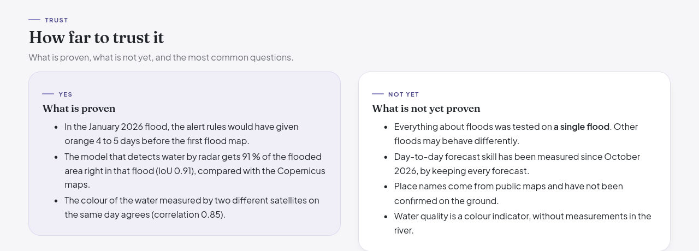

# 11. Validation and limitations

[Documentation home](README.md) · Previous: [10. Developer guide](10-developer-guide.md) · Next: [12. Glossary and references](12-glossary-and-references.md)

A public warning service is only as useful as the trust it deserves. This page gathers, in one place, what the tests
show, what they do not, and what was tried and rejected.

## How the tests were designed

- **Set on the past, tested on the future.** Alert limits use data up to 2021; models are trained up to 2019 (Model
  A) or 2021 (Model C) and tested on 2022-2026.
- **An independent reference.** The flood map of Copernicus EMS activation EMSR857 (January 2026) was made by another
  team, with other methods; it was never used to choose anything for Model A.
- **Spatial blocks.** Where part of an event must be used for training (Model B), the map is cut into 3 km blocks, and
  each block is predicted by a model that never saw it.
- **Leave one year out.** Water-colour models predict each year with a model trained on the others.
- **Another satellite.** Water-colour models trained on Sentinel-2 are tested on Landsat images.
- **A simple baseline every time.** Each model is compared with a rule anyone can compute: a radar threshold,
  persistence ("tomorrow equals today"), the time of year, the latest measurement.
- **Choices stated before the results.** The algorithm selection criteria were written before the comparisons were run.

## What the tests show

| Claim | Evidence | Strength |
|---|---|---|
| The alert rules would have warned before the January 2026 flood | Orange on 12 January; first flood map on 17 January (5 days) | One event, observed (not forecast) flow |
| The limits are not fitted to the test years | Calibrated 1997-2021 (or 2006-2021), tested 2022-2026 | Good |
| Radar finds the flooded area | Model B against Copernicus EMS: IoU 0.91, F1 0.95, precision 0.985, recall 0.92 | One event, new places of it |
| The terrain explains where it floods | Model A, never shown the 2026 flood: ROC-AUC 0.96 | One event |
| Our flow model beats persistence | Model C on 2022-2026: better at every lead (NSE 0.44 vs 0.21 at 7 days) | Five test years |
| The colour index is repeatable | Sentinel-2 vs Landsat on the same day: r 0.85 over 438 pairs (Q3 and Q6 excepted) | Good |
| The tide drives the morning colour of the lower river | R² 0.19 → 0.60 with the M2 phase alone; 0.68 with the final model; holds on another satellite | Good, relative index |
| The water-colour forecast is a useful guide | Right or one step off on 84 % of days at 1 day, 77 % at 30 days, vs 69 % for the season | Modest; R² 0.2-0.4 |

## What is not proven

- **Everything about floods rests on one event.** January 2026 is the only flood with an independent map inside the
  study area (the February 2023 activation mapped nothing inside it). A slower, smaller or differently shaped flood
  could behave differently.
- **The skill of the 10-day forecast at Marracuene.** No archive of past GloFAS forecasts for this site was available,
  so the alerts were tested on observed flow. Every daily forecast has been archived since October 2026 to measure
  this.
- **The flow numbers are model estimates.** There is no public river gauge at Marracuene; GloFAS is a global model,
  and its two versions differ by up to 25 % at the 2026 peak.
- **The place names** come from open maps and have not been confirmed on the ground.
- **Water quality is a colour indicator.** There are no in-situ measurements: no turbidity, suspended solids, Secchi
  depth or conductivity samples. The team decided not to take field measurements in this phase. The colour index is
  therefore relative (today against the river's own history); absolute values in FNU or mg/L are not validated.
- **The satellite cannot see what matters most for health**: germs, chemicals, pH. The platform never says the water is
  safe.

## Known limitations

| Area | Limitation | How the platform handles it |
|---|---|---|
| Radar | Wet fields and built-up areas can look like water (about 33 km² of false flood in dry months) | Model B maps are context only; warning zones come from the EMS maps |
| Radar | Two relative orbits mixed in the composites; 2015 has one | Incidence angle is an input; radar models start in 2016 |
| Susceptibility | Model A classes are broad (52,000 buildings in "medium") | Not used for public warnings |
| Warning zones | They show where water went in 2026, not where any flood will go | Said on the page; zones and places to be revised after the next mapped flood |
| Exposure | WorldPop (24,700 people) is inconsistent with building counts (1,935) | Buildings preferred; "up to about" when people are shown |
| Optical | Clouds hide floods; the muddiest flood water can read as land | Radar for floods; a caution on monthly colour maps in flood months |
| Narrow river | Sections Q1-Q6 are 50-80 m wide | Sentinel-2 only there, from 2017 |
| Two sections | Q3 and Q6 disagree between satellites | Marked "reduced reliability"; no warning there |
| Upstream reach of the district | Colour model R² 0.20 | No colour forecast there |
| Satellite hour | Optical images are taken at about 09:30 local time | Colour forecasts are for that hour only |
| Water-colour images | Refreshed weekly from the project computer (Earth Engine), not by the daily workflow | The page always says the date of the image |
| Hosting | The free host puts the app to sleep and has no service guarantee | Keep-awake visits every 4 hours; light page on GitHub Pages as fallback |
| Alerts by WhatsApp | Not live yet (Meta account, templates, database) | The form says sign-ups open soon; the leaders' message works today |

## Open checks

- A later look at the January 2026 reference suggested that some "not water" samples derived from the Copernicus EMS
  maps lie on the permanent river channel (the EMS maps show flood water, not the usual river). For a water detector
  this would count correct answers as false alarms, so it would lower, not raise, the reported precision. It has not
  yet been re-checked for Model B.
- Re-downloading the Sentinel-1 composites with a single relative orbit (about 6.7 GB) would remove the mixing of
  viewing angles; it was evaluated and not done.

## Tested and rejected

| Module | What was tested | Why it was rejected |
|---|---|---|
| Data | Landsat 5/7 → 8 harmonisation (Roy et al., 2016) | Water MNDWI of Landsat 7 fell from 0.68 to 0.16 |
| Radar | Monthly median as the flood signal | Misses short floods (ROC-AUC 0.75 vs 0.97 for the 10th percentile) |
| Radar | A fixed change threshold | Confuses drought with flood |
| Model B | Terrain inputs | The model learns where water usually is |
| Model B | Optical inputs | Empty under clouds, exactly during floods |
| Model A | JRC occurrence, same-month Landsat | They leak the label |
| Model A | Weather inputs | A small gain, but a susceptibility map must describe the land, not a month |
| Warnings | Model A classes as warning zones | Too broad |
| Water quality | FNU from the near-infrared band | Satellites disagree (r 0.21) |
| Water quality | NDCI as chlorophyll | Follows sediment (r 0.81 with NDTI) |
| Water quality | Flow, rain and season without the tide | No better than the time of year |
| Water quality | Wind, local rain, rain per sub-basin, training on both satellites | No gain in the probability of turbid water |
| Water quality | A monthly "expected turbidity" model per section | Works only at the estuary (R² 0.52) |
| Water quality | The border section as a predictor for Marracuene | Unrelated (r -0.06) |
| Platform | Model B maps as public flood maps | Over-flag built-up areas |
| Platform | Tabs and dense dashboards | Hid the one thing people need; replaced by pages read top to bottom |
